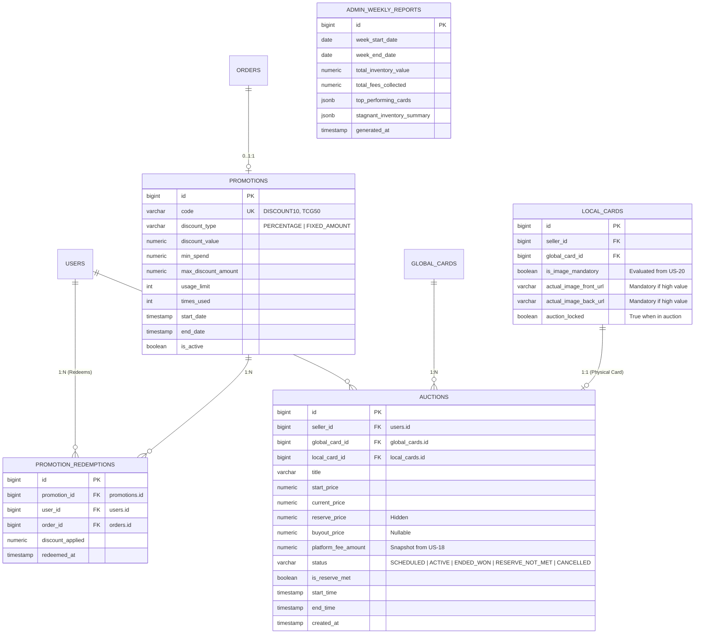

# 🎯 Mythix TCG Platform — Final Phase 2 User Stories Specification
> **เอกสารสรุปขอบเขตข้อกำหนดและ User Stories ฉบับสุดท้ายประจำ Phase 2 (Final Scope Agreement)**  
> **Repository:** `User-FlowANDFigma-Progress`  
> **Directory:** `/User Story & Flow/final_user_story_phase_2.md`  
> **Branch:** `main`  
> **การปรับปรุง:** คัดเลือกและจัดลำดับความสำคัญตามคำแนะนำและการประเมินของอาจารย์ที่ปรึกษาโครงงาน  
> **วันจัดทำ:** พฤศจิกายน 2026  

---

## 📑 สารบัญ (Table of Contents)
1. [บทนำและผลการตัดสินใจขอบเขตงาน (Scope Finalization & Overview)](#1-บทนำและผลการตัดสินใจขอบเขตงาน-scope-finalization--overview)
2. [ตารางสรุปการคัดเลือกและจัดลำดับความสำคัญ (Master Priority Matrix)](#2-ตารางสรุปการคัดเลือกและจัดลำดับความสำคัญ-master-priority-matrix)
3. [รายละเอียดเชิงลึก: กลุ่ม Must-Have — แกนหลักระบบประมูล (US-13, US-18)](#3-รายละเอียดเชิงลึก-กลุ่ม-must-have--แกนหลักระบบประมูล-us-13-us-18)
   - [หมวด US-13: การสร้างและจัดการรายการประมูล (Auction Listing & Setup)](#หมวด-us-13-การสร้างและจัดการรายการประมูล-auction-listing--setup)
   - [หมวด US-18: การเงิน ค่าธรรมเนียม และสถิติการประมูล (Auction Analytics & Financials)](#หมวด-us-18-การเงิน-ค่าธรรมเนียม-และสถิติการประมูล-auction-analytics--financials)
4. [รายละเอียดเชิงลึก: กลุ่ม Recommended to Develop — ฟีเจอร์สำคัญที่เลือกพัฒนาเพิ่ม (US-20, US-24, US-27, US-29)](#4-รายละเอียดเชิงลึก-กลุ่ม-recommended-to-develop--ฟีเจอร์สำคัญที่เลือกพัฒนาเพิ่ม-us-20-us-24-us-27-us-29)
   - [หมวด US-20: ระบบรูปภาพและเกณฑ์การบังคับใส่ภาพถ่ายจริง (Card Image Upload Policy & Criteria Gate)](#หมวด-us-20-ระบบรูปภาพและเกณฑ์การบังคับใส่ภาพถ่ายจริง-card-image-upload-policy--criteria-gate)
   - [หมวด US-24: ระบบโปรโมชันและโค้ดส่วนลด (Promotions & Discount Codes Engine)](#หมวด-us-24-ระบบโปรโมชันและโค้ดส่วนลด-promotions--discount-codes-engine)
   - [หมวด US-27: รายงานสรุปสต๊อกและกำไรรายสัปดาห์สำหรับแอดมิน (Weekly Stock & Profit Admin Report)](#หมวด-us-27-รายงานสรุปสต๊อกและกำไรรายสัปดาห์สำหรับแอดมิน-weekly-stock--profit-admin-report)
   - [หมวด US-29: ระบบการแจ้งเตือนหลายช่องทางและอีเมลอัตโนมัติ (Multi-Channel In-App & Email Notification System)](#หมวด-us-29-ระบบการแจ้งเตือนหลายช่องทางและอีเมลอัตโนมัติ-multi-channel-in-app--email-notification-system)
5. [สรุปสาระสำคัญ: กลุ่ม Good to Have — วงจรการประมูลและการกำกับดูแล (US-14, US-15, US-16, US-17, US-19)](#5-สรุปสาระสำคัญ-กลุ่ม-good-to-have--วงจรการประมูลและการกำกับดูแล-us-14-us-15-us-16-us-17-us-19)
6. [รายการฟีเจอร์ที่ข้ามไปก่อน (Deferred / Out of Scope)](#6-รายการฟีเจอร์ที่ข้ามไปก่อน-deferred--out-of-scope)
7. [สถาปัตยกรรมฐานข้อมูลที่ต้องเพิ่มใน Phase 2 (Target Database Schema Extension)](#7-สถาปัตยกรรมฐานข้อมูลที่ต้องเพิ่มใน-phase-2-target-database-schema-extension)
8. [แผนงานการพัฒนาและการแบ่ง Sprint (Sprint Delivery Roadmap)](#8-แผนงานการพัฒนาและการแบ่ง-sprint-sprint-delivery-roadmap)

---

## 1. บทนำและผลการตัดสินใจขอบเขตงาน (Scope Finalization & Overview)

จากการนำเสนอชุด Requirements สำหรับ Phase 2 ต่ออาจารย์ที่ปรึกษา ทางกลุ่มได้รับคำแนะนำและข้อสรุปในการจัดทิศทางการพัฒนา (Scoping Decision) ดังนี้:

1. **แกนหลักที่ขาดไม่ได้ (Must-Have):** ได้แก่ **US-13** (การสร้างและตั้งค่าการประมูล) และ **US-18** (การเงิน สถิติ และค่าธรรมเนียมการประมูล) ซึ่งเป็นหัวใจสำคัญทางธุรกิจของการประมูลการ์ด
2. **ฟีเจอร์ที่อาจารย์แนะนำให้พัฒนาเพิ่ม (Recommended to Develop):** ได้แก่ **US-20** (เกณฑ์การบังคับรูปถ่ายจริงตามมูลค่า/สภาพการ์ด), **US-24** (ระบบโค้ดส่วนลด/โปรโมชัน), **US-27** (รายงานสรุปสต๊อกและกำไรประจำสัปดาห์สำหรับแอดมิน), และ **US-29** (ระบบแจ้งเตือนหลายช่องทางทั้งในเว็บและอีเมลอัตโนมัติ 16 เหตุการณ์สำคัญ) เพื่อยกระดับความสมบูรณ์ของระบบ e-Commerce และเพิ่มคะแนนประเมิน
3. **ฟีเจอร์สนับสนุนที่ควรทำหากมีเวลาพอ (Good to Have):** ได้แก่ **US-14, US-15, US-16, US-17, US-19** ซึ่งเป็นระบบห้องประมูลสด กลไกการเคาะราคา Anti-Sniping การปิดออเดอร์โอนเข้า Personal Binder และการกำกับดูแล/ยกเลิกฉุกเฉินสำหรับแอดมิน
4. **ฟีเจอร์ที่ข้ามไปก่อน (Deferred / Out of Scope):** ข้ออื่นๆ ในหมวด US-20 ถึง US-28 (`US-21, US-22, US-23, US-25, US-26, US-28`) ให้ตัดออกหรือยกยอดไปก่อน เพื่อควบคุมขนาดของงานและส่งมอบได้ทันกำหนด

---

## 2. ตารางสรุปการคัดเลือกและจัดลำดับความสำคัญ (Master Priority Matrix)

| รหัสหมวด | ชื่อหมวดหมู่ (Module Title) | สถานะความสำคัญตามคำแนะนำอาจารย์ | จำนวน US ย่อย | เป้าหมายการส่งมอบ |
| :---: | :--- | :---: | :---: | :---: |
| **US-13** | **Auction Listing & Setup** (สร้าง/ตั้งค่าประมูล, Reserve Price, Buy-It-Now) | ⭐ **MUST HAVE** | 5 ข้อ | **Sprint 1 (Priority 1)** |
| **US-18** | **Auction Analytics & Financials** (คำนวณค่าธรรมเนียม, สถิติกำไรผู้ขาย/ผู้ซื้อ) | ⭐ **MUST HAVE** | 3 ข้อ | **Sprint 1 (Priority 1)** |
| **US-20** | **Card Image Upload Policy & Criteria Gate** (เกณฑ์บังคับรูปจริง vs ตัวเลือกเสริม) | 🚀 **RECOMMENDED** | 2 ข้อ | **Sprint 1 (Priority 1)** |
| **US-24** | **Promotions & Discount Codes Engine** (ระบบคูปองและโค้ดส่วนลด Checkout) | 🚀 **RECOMMENDED** | 2 ข้อ | **Sprint 2 (Priority 1)** |
| **US-27** | **Weekly Stock & Profit Admin Report** (รายงานสินค้าคงคลังและผลกำไรประจำสัปดาห์) | 🚀 **RECOMMENDED** | 1 ข้อ | **Sprint 2 (Priority 1)** |
| **US-29** | **Multi-Channel Email & In-App Alerts** (แผนผังแจ้งเตือน 16 เหตุการณ์สำคัญ) | 🚀 **RECOMMENDED** | 3 ข้อ | **Sprint 2 (Priority 1)** |
| **US-14** | **Auction Discovery & Live Arena** (หน้ารวมประมูล, WebSocket Room, Watchlist) | 💡 **GOOD TO HAVE** | 5 ข้อ | **Sprint 2 (Priority 2)** |
| **US-15** | **Bidding Engine & Proxy Bids** (เคาะสด, บิดอัตโนมัติ Max Bid, แจ้งเตือน Outbid) | 💡 **GOOD TO HAVE** | 5 ข้อ | **Sprint 2 (Priority 2)** |
| **US-16** | **Fair-Play & Anti-Fraud Controls** (Dynamic Anti-Sniping 3 นาที, ป้องกันปั่นราคา) | 💡 **GOOD TO HAVE** | 4 ข้อ | **Sprint 2 (Priority 2)** |
| **US-17** | **Resolution, Settlement & Ownership** (ตัดสินผู้ชนะ, ชำระเงิน 48 ชม., โอนเข้า Binder) | 💡 **GOOD TO HAVE** | 6 ข้อ | **Sprint 2 (Priority 2)** |
| **US-19** | **Auction Administration & Dispute Handling** (มอนิเตอร์สด, สั่งระงับ/ยกเลิกฉุกเฉิน, ตรวจสอบหลักฐาน) | 💡 **GOOD TO HAVE** | 4 ข้อ | **Sprint 2 (Priority 2)** |
| `US-21` | *Middleman Escrow Fee & Monthly Dashboard* | ⏸️ *DEFERRED (ข้ามไปก่อน)* | — | รวมอยู่ใน US-18 แล้ว |
| `US-22` | *Collection Privacy & Showcase Viewer* | ⏸️ *DEFERRED (ข้ามไปก่อน)* | — | Phase 1 มี US-10-6 แล้ว |
| `US-23` | *Product Categories & Advanced Filtering* | ⏸️ *DEFERRED (ข้ามไปก่อน)* | — | ใช้ตัวกรองเดิม US-02-1 |
| `US-25` | *Order History & Reorder, PDF Summary Export* | ⏸️ *DEFERRED (ข้ามไปก่อน)* | — | ยกยอดหลังส่งมอบหลัก |
| `US-26` | *Out of Stock Alert & Smart Restock Prediction* | ⏸️ *DEFERRED (ข้ามไปก่อน)* | — | ซับซ้อนเกินกรอบเวลา |
| `US-28` | *Tolerant Search (Typo) & Multilingual Search* | ⏸️ *DEFERRED (ข้ามไปก่อน)* | — | โบนัสเสริม ยกยอดไว้ก่อน |

---

## 3. รายละเอียดเชิงลึก: กลุ่ม Must-Have — แกนหลักระบบประมูล (US-13, US-18)

---

### หมวด US-13: การสร้างและจัดการรายการประมูล (Auction Listing & Setup)

#### 🔹 US-13-1: Create Card Auction Listing from Catalog/Collection
* **User Story:**  
  *ในฐานะผู้ขายที่ได้รับการรับรอง (Verified Seller)*  
  *ฉันต้องการสร้างรายการประมูลการ์ดใบใหม่ โดยดึงข้อมูลพื้นฐานจากการ์ดต้นแบบในแคตตาล็อก และระบุสภาพการ์ดจริง พร้อมภาพถ่ายจริง*  
  *เพื่อเปิดห้องประมูลการ์ดสะสมหายากในระบบอย่างถูกต้องและโปร่งใส*
* **Acceptance Criteria:**
  - [x] ผู้ขายต้องมีสถานะ `seller_status = 'APPROVED'` (ผ่านเกณฑ์ KYC จาก Phase 1) จึงจะเข้าถึงฟังก์ชันสร้างห้องประมูลได้
  - [x] ผู้ขายเลือกการ์ดต้นแบบ (`global_card_id`) เพื่อดึงชื่อ เซ็ต รูปภาพ และข้อมูลพื้นฐาน
  - [x] ผู้ขายระบุสภาพการ์ดจริง (NM, LP, MP, HP, DMG) และสามารถระบุการเกรดการ์ด (PSA/BGS/CGC พร้อมเลข Cert No.)
  - [x] กำหนดราคาเริ่มต้นประมูล (`start_price`) มากกว่า 0 บาท
  - [x] การ์ดที่ถูกนำมาตั้งประมูลจะถูกล็อกสถานะ (`auction_locked = true`) ทันที ป้องกันการนำไปขายซ้ำในหน้าร้าน Direct Sale
* **API Endpoints:** `POST /api/seller/auctions`

#### 🔹 US-13-2: Configure Hidden Reserve Price & Buy-It-Now Option
* **User Story:**  
  *ในฐานะผู้ขาย (Verified Seller)*  
  *ฉันต้องการตั้งราคาสำรองขั้นต่ำที่ซ่อนไว้ (Hidden Reserve Price) และราคาซื้อขาดทันที (Buy-It-Now)*  
  *เพื่อป้องกันความเสี่ยงจากการขายการ์ดขาดทุน และเปิดโอกาสให้ผู้ซื้อที่รีบใช้งานสามารถปิดประมูลได้ทันที*
* **Acceptance Criteria:**
  - [x] รองรับการเปิดใช้งาน "Reserve Price" โดยตัวเลขต้อง `>= start_price` และระบบต้องซ่อนตัวเลขนี้จากหน้าจอผู้ซื้อ (แสดงเพียงสถานะ `is_reserve_met = false/true`)
  - [x] รองรับการเปิดใช้งาน "Buy-It-Now Price" โดยตัวเลขต้อง `> reserve_price` และ `> start_price`
  - [x] หากมีผู้ใช้กดซื้อในราคา Buy-It-Now ห้องประมูลจะปิดตัวลงทันที (`BUYOUT_COMPLETED`) และสร้างออเดอร์คำสั่งซื้อทันที
* **API Endpoints:** ส่วนหนึ่งของ Payload ใน `POST /api/seller/auctions`

#### 🔹 US-13-3: Schedule Auction Start Time & Duration
* **User Story:**  
  *ในฐานะผู้ขาย (Verified Seller)*  
  *ฉันต้องการตั้งเวลาเริ่มการประมูลล่วงหน้า (Scheduled) หรือเปิดทันที และเลือกระยะเวลาการประมูล (1, 3, 5, 7 วัน)*  
  *เพื่อให้การประมูลสิ้นสุดในวันและเวลาที่มีกลุ่มเป้าหมายออนไลน์มากที่สุด*
* **Acceptance Criteria:**
  - [x] ตัวเลือกเริ่มทันที (`start_now = true`) ปรับสถานะเป็น `ACTIVE`
  - [x] ตัวเลือกตั้งเวลาล่วงหน้า ต้องกำหนดเวลาเริ่มล่วงหน้าอย่างน้อย 15 นาที สถานะเป็น `SCHEDULED`
  - [x] ตัวเลือกระยะเวลา: 24 ชั่วโมง, 3 วัน, 5 วัน, และ 7 วัน
  - [x] บันทึกเวลา `end_time` ด้วย Server UTC Timestamp เพื่อความแม่นยำ
* **API Endpoints:** `POST /api/seller/auctions/schedule`

#### 🔹 US-13-4: Seller Auction Dashboard & Draft Management
* **User Story:**  
  *ในฐานะผู้ขาย (Verified Seller)*  
  *ฉันต้องการหน้าแดชบอร์ดจัดการการประมูลของฉัน เพื่อดูและคัดกรองห้องประมูลในสถานะต่างๆ (Drafts, Scheduled, Active, Ended)*  
  *เพื่อติดตามสถานะการประมูล และแก้ไขรายการร่างก่อนเผยแพร่จริง*
* **Acceptance Criteria:**
  - [x] แดชบอร์ดแสดงแท็บแยกสถานะชัดเจน: Drafts, Scheduled, Active, Ended & Awaiting Payment, Completed
  - [x] แสดงราคาเคาะสูงสุดปัจจุบัน จำนวนครั้งที่เคาะ (Bids Count) และเวลานับถอยหลัง
  - [x] รายการสถานะ Draft สามารถแก้ไขหรือลบทิ้งได้ตลอดเวลา
* **API Endpoints:** `GET /api/seller/auctions`

#### 🔹 US-13-5: Seller Auction Early Cancellation Rules
* **User Story:**  
  *ในฐานะผู้ขายและระบบ (Seller & System)*  
  *ฉันต้องการกฎเกณฑ์การยกเลิกการประมูลที่ชัดเจน เพื่อคุ้มครองความเชื่อมั่นของผู้เข้าร่วมประมูลทุกคน*  
* **Acceptance Criteria:**
  - [x] หากห้องประมูลยังไม่มีผู้ใดเคาะราคา (0 Bids) ผู้ขายสามารถกดยกเลิกการประมูล (`CANCELLED`) ได้ด้วยตนเอง
  - [x] หากห้องประมูลมีผู้เคาะราคาแล้วอย่างน้อย 1 ครั้ง ผู้ขายจะไม่สามารถกดยกเลิกได้เอง (ต้องติดต่อแอดมินพร้อมเหตุผลจำเป็น)
  - [x] เมื่อยกเลิกสำเร็จ การ์ดจะถูกปลดล็อกกลับคืนสู่สต๊อกของผู้ขาย
* **API Endpoints:** `DELETE /api/seller/auctions/{auctionId}`

---

### หมวด US-18: การเงิน ค่าธรรมเนียม และสถิติการประมูล (Auction Analytics & Financials)

#### 🔹 US-18-1: Seller Auction Revenue, Cost & Net Margin Analytics
* **User Story:**  
  *ในฐานะผู้ขาย (Verified Seller)*  
  *ฉันต้องการดูรายงานวิเคราะห์ผลลัพธ์ทางการเงินของการประมูล เปรียบเทียบต้นทุนกับราคาจบประมูลและกำไรสุทธิ*  
  *เพื่อประเมินผลกำไรและความคุ้มค่าของการนำการ์ดมาประมูลเมื่อเทียบกับการตั้งขายราคาคงที่*
* **Acceptance Criteria:**
  - [x] รายงานสรุป: ยอดประมูลรวม (Gross Auction Volume), ต้นทุนสินค้ารวม (Total Card Cost จาก Snapshot), และกำไรสุทธิ (Net Realized Profit)
  - [x] กราฟเปรียบเทียบราคาตั้งต้น (Start Price) vs ราคาจบประมูลจริง (Realized Final Bid)
  - [x] คำนวณอัตรากำไร (Profit Margin %): $\frac{\text{Realized Price} - \text{Cost} - \text{Platform Fee}}{\text{Cost}} \times 100$
* **API Endpoints:** `GET /api/seller/auctions/analytics`

#### 🔹 US-18-2: Platform Auction Fee & Commission Auto-Deduction
* **User Story:**  
  *ในฐานะผู้บริหารแพลตฟอร์ม (Platform Admin)*  
  *ฉันต้องการให้ระบบคำนวณและหักค่าธรรมเนียมการประมูลของแพลตฟอร์ม (Platform Commission Fee) โดยอัตโนมัติจากยอดปิดประมูล*  
  *เพื่อสร้างโมเดลรายได้ที่ชัดเจนสำหรับนำไปใช้ดำเนินงานและคุ้มครองความปลอดภัยของระบบ*
* **Acceptance Criteria:**
  - [x] ระบบรองรับการตั้งค่าอัตราค่าธรรมเนียมประมูล (เช่น 3% หรือ 5% ของราคาจบประมูล กำหนดขั้นต่ำ 20 บาท)
  - [x] ในหน้าสรุปยอดรับเงินของผู้ขาย มีการแจกแจงรายการหักค่าธรรมเนียมอย่างโปร่งใส
  - [x] บันทึกรายได้ค่าธรรมเนียมเข้าบัญชีกลางของระบบเมื่อออเดอร์เสร็จสิ้น (`FULFILLED`)
* **API Endpoints:** `POST /api/admin/commission-policy`, `GET /api/seller/auctions/{id}/settlement-summary`

#### 🔹 US-18-3: Buyer Personal Auction Portfolio & Win-Rate Stats
* **User Story:**  
  *ในฐานะนักสะสม (Collector / Buyer)*  
  *ฉันต้องการดูสถิติการประมูลส่วนตัว ประวัติการชนะประมูล อัตราการชนะ (Win Rate) และมูลค่ารวมที่ประมูลได้*  
  *เพื่อสะสมผลงานความสำเร็จและติดตามงบประมาณในการสะสมการ์ดของตนเอง*
* **Acceptance Criteria:**
  - [x] หน้าโปรไฟล์ผู้ใช้มีแท็บ "Auction Portfolio": แสดงจำนวนครั้งที่เคาะ (Bids Placed), จำนวนห้องที่ชนะ (Auctions Won), และ Win Rate (%)
  - [x] สรุปมูลค่าเงินรวมที่ลงทุนประมูลการ์ดสำเร็จ (Total Invested Volume)
* **API Endpoints:** `GET /api/user/auction-portfolio`

---

## 4. รายละเอียดเชิงลึก: กลุ่ม Recommended to Develop — ฟีเจอร์สำคัญที่เลือกพัฒนาเพิ่ม (US-20, US-24, US-27)

---

### หมวด US-20: ระบบรูปภาพและเกณฑ์การบังคับใส่ภาพถ่ายจริง (Card Image Upload Policy & Criteria Gate)

#### 🔹 US-20-1: Mandatory vs. Optional Real Card Image Upload Gate
* **User Story:**  
  *ในฐานะผู้ขายและระบบ (Seller & Platform System)*  
  *ฉันต้องการให้ระบบประเมินและบังคับอัปโหลดภาพถ่ายการ์ดจริงตามเกณฑ์มูลค่า สภาพ และความหายากของการ์ด*  
  *เพื่อสร้างความโปร่งใส ป้องกันปัญหาการหลอกลวงสภาพการ์ด และช่วยให้การลงขายการ์ดทั่วไปทำได้อย่างรวดเร็ว*
* **เกณฑ์การตัดสินใจ (Business Validation Rules Matrix):**

| เงื่อนไขของการ์ด (Card Attributes) | เกณฑ์การอัปโหลดรูปถ่าย (Upload Rule) | เหตุผลและความจำเป็น |
| :--- | :---: | :--- |
| **ราคา >= 500 บาท** | 🔴 **บังคับใส่รูปจริง (Mandatory)** | การ์ดมูลค่าสูง ผู้ซื้อต้องเห็นภาพสภาพจริงประกอบการตัดสินใจ |
| **การ์ดเกรดทุกใบ (Graded Cards: PSA/BGS/CGC)** | 🔴 **บังคับใส่รูปจริง (Mandatory)** | ต้องตรวจสอบเลขใบรับรอง (Cert No.) และสภาพตลับเกรด |
| **สภาพมีตำหนิ (LP, MP, HP, DMG)** | 🔴 **บังคับใส่รูปจริง (Mandatory)** | ต้องแสดงรอยขนแมว ขอบขาว หรือรอยพับให้ชัดเจน ป้องกันข้อพิพาท |
| **การ์ดระดับหายากพิเศษ (SR, SAR, Alt-Art)** | 🔴 **บังคับใส่รูปจริง (Mandatory)** | ป้องกันการใช้รูป Official หลอกขายการ์ดปลอมหรือสภาพเยิน |
| **การ์ดทั่วไป (Common/Uncommon/Regular) + สภาพ NM + ราคา < 500 บาท** | 🟢 **ตัวเลือกเสริม (Optional)** | อนุญาตให้ใช้รูปมาตรฐานจาก Global Master Catalog ได้ เพื่อความรวดเร็ว |

* **Acceptance Criteria:**
  - [x] เมื่อผู้ขายกรอกฟอร์มลงขายสินค้า (`/seller/products/new`) ระบบจะประเมินเกณฑ์แบบเรียลไทม์
  - [x] หากเข้าเงื่อนไข Mandatory ผู้ขายต้องอัปโหลดรูปจริงอย่างน้อย 2 ภาพ (ด้านหน้าและด้านหลัง) จึงจะสามารถกดปุ่มยืนยันลงขายได้
  - [x] หากเข้าเงื่อนไข Optional ระบบจะติ๊กเลือกใช้รูปจาก Master Catalog ให้เป็นค่าเริ่มต้น แต่ยังเปิดให้อัปโหลดรูปจริงเพิ่มได้
  - [x] มี Client & Server-side Validation ตรวจสอบนามสกุลไฟล์ (.jpg, .png, .webp) และจำกัดขนาดไม่เกิน 5MB ต่อภาพ
* **API Endpoints:** `POST /api/seller/products/validate-listing-rules`

#### 🔹 US-20-2: High-Resolution Card Gallery with Zoom Magnifier
* **User Story:**  
  *ในฐานะผู้ซื้อ (Customer)*  
  *ฉันต้องการดูรูปถ่ายจริงของการ์ดแบบซูมขยายความละเอียดสูง (Magnifier Zoom)*  
  *เพื่อตรวจสอบมุม ขอบ และรอยตำหนิของการ์ดจริงอย่างละเอียดก่อนตัดสินใจสั่งซื้อ*
* **Acceptance Criteria:**
  - [x] หน้ารายละเอียดการ์ดมีแท็บสลับระหว่าง "Official Art" และ "Actual Card Photos"
  - [x] รองรับการนำเมาส์ไปชี้ (Hover) เพื่อซูมส่องรอยตำหนิและขอบการ์ดในอัตราขยาย 2.5x
* **UI Component:** `CardPhotoMagnifierViewer.tsx`

---

### หมวด US-24: ระบบโปรโมชันและโค้ดส่วนลด (Promotions & Discount Codes Engine)

#### 🔹 US-24-1: Promo Code Application & Validation at Checkout
* **User Story:**  
  *ในฐานะผู้ซื้อ (Customer)*  
  *ฉันต้องการกรอกโค้ดส่วนลดโปรโมชันในหน้า Checkout เพื่อรับส่วนลดราคาสินค้าหรือค่าบริการ*  
  *เพื่อประหยัดค่าใช้จ่ายและได้รับสิทธิประโยชน์จากแคมเปญส่งเสริมการขาย*
* **Acceptance Criteria:**
  - [x] ในหน้า Checkout สรุปรายการสั่งซื้อ มีช่องกรอก **"Promo / Discount Code"** พร้อมปุ่ม "Apply"
  - [x] ระบบรองรับการลดราคา 2 รูปแบบ:
    1. **Percentage Discount (ลดเป็นเปอร์เซ็นต์):** เช่น ลด 10% (มีเพดานส่วนลดสูงสุด เช่น ไม่เกิน 200 บาท)
    2. **Fixed Amount Discount (ลดเป็นจำนวนเงิน):** เช่น ลดทันที 50 บาท เมื่อยอดสั่งซื้อครบขั้นต่ำ 500 บาท
  - [x] ตรวจสอบเงื่อนไขความถูกต้อง (Validation Rules):
    - โค้ดยังไม่หมดอายุ (`start_date <= NOW() <= end_date`)
    - ยอดรวมถึงยอดขั้นต่ำที่กำหนด (`total_amount >= min_spend`)
    - สิทธิ์การใช้งานของโค้ดยังไม่เต็มโควตา (`times_used < usage_limit`)
    - ผู้ใช้ไม่เคยใช้โค้ดนี้เกินจำนวนสิทธิ์ที่อนุญาต (เช่น 1 ครั้งต่อบัญชี)
  - [x] เมื่อโค้ดผ่านเกณฑ์ ระบบคำนวณยอดชำระสุทธิใหม่ทันทีและแสดงแถว *"Discount: -฿XX"*
* **API Endpoints:** `POST /api/promotions/validate-code`, `POST /api/orders/apply-promo`

#### 🔹 US-24-2: Admin Promo Campaign Management
* **User Story:**  
  *ในฐานะผู้ดูแลระบบ (Platform Admin)*  
  *ฉันต้องการสร้าง แก้ไข เปิด/ปิด และติดตามสถิติการใช้งานโค้ดโปรโมชัน*  
  *เพื่อบริหารจัดการแคมเปญการตลาดและกระตุ้นยอดขายบนแพลตฟอร์ม*
* **Acceptance Criteria:**
  - [x] แอดมินมีหน้าจัดการโปรโมชัน (`/admin/promotions`) สำหรับสร้างโค้ดใหม่: กำหนดรหัสโค้ด, ชนิดส่วนลด, วันเริ่มต้น-สิ้นสุด, ยอดซื้อขั้นต่ำ, และจำนวนสิทธิ์
  - [x] แสดงสถิติจำนวนครั้งที่ถูกนำไปใช้ และยอดเงินส่วนลดรวมที่แพลตฟอร์มสนับสนุน
* **API Endpoints:** `GET /api/admin/promotions`, `POST /api/admin/promotions`, `PATCH /api/admin/promotions/{id}/status`

---

### หมวด US-27: รายงานสรุปสต๊อกและกำไรรายสัปดาห์สำหรับแอดมิน (Weekly Stock & Profit Admin Report)

#### 🔹 US-27-1: Automated Weekly Stock & Profit Platform Governance Report
* **User Story:**  
  *ในฐานะผู้ดูแลระบบ (Platform Admin)*  
  *ฉันต้องการรายงานสรุปสินค้าคงคลัง ความเคลื่อนไหวของสต๊อก และผลกำไรประจำสัปดาห์ของทั้งแพลตฟอร์ม*  
  *เพื่อใช้กำกับดูแลความเสี่ยง ติดตามมูลค่าทางเศรษฐกิจ และประเมินสุขภาพทางการเงินของแพลตฟอร์ม*
* **Acceptance Criteria:**
  - [x] ระบบมี Scheduled Cron Job ทำงานอัตโนมัติทุกวันอาทิตย์ เวลา 23:59 UTC เพื่อสรุปข้อมูลรอบสัปดาห์
  - [x] รายงานประจำสัปดาห์ครอบคลุม 4 มิติสำคัญ:
    1. **Stock Movement:** สต๊อกเข้าใหม่, สินค้าที่ขายออกไปแล้ว, และมูลค่าสินค้าคงคลังรวม (Total Inventory Value)
    2. **Profit & Commission Fees:** ยอดค่าธรรมเนียมที่แพลตฟอร์มเก็บได้ในรอบสัปดาห์
    3. **Top 10 Performing Cards:** การ์ดที่ทำยอดขายสูงสุดและกำไรสูงสุดในสัปดาห์นั้น
    4. **Stagnant Inventory:** รายการสินค้าที่ค้างสต๊อกเกิน 60 วันโดยไม่มีการซื้อขาย
  - [x] แอดมินสามารถเปิดดูรายงานย้อนหลังใน Admin Console และมีปุ่มกด Export เป็นไฟล์ CSV / Excel หรือ PDF
* **API Endpoints:** `GET /api/admin/reports/weekly-summary`, `GET /api/admin/reports/weekly-summary/export`

---

### หมวด US-29: ระบบการแจ้งเตือนหลายช่องทางและอีเมลอัตโนมัติ (Multi-Channel In-App & Email Notification System)

หมวดนี้กำหนดสถาปัตยกรรมและพฤติกรรมการแจ้งเตือนทั้งผ่านระบบหน้าเว็บ (In-App Notification) และผ่านทางอีเมล (Automated Email Notification) ครอบคลุม 16 เหตุการณ์สำคัญของระบบการซื้อขาย การประมูล และการบริหารจัดการบัญชี เพื่อสร้างความโปร่งใส ความน่าเชื่อถือ และช่วยให้ผู้ใช้ไม่พลาดขั้นตอนสำคัญ:

#### 📊 ตารางสรุปแผนผังการแจ้งเตือน 16 เหตุการณ์หลัก (Master Multi-Channel Notification Matrix)

| ที่ | เหตุการณ์ (Event / Trigger) | ผู้รับ (Recipient) | ในเว็บตอนนี้ (Current In-Web) | แผนในเว็บ (Planned In-Web) | แผนอีเมล (Planned Email) |
| :---: | :--- | :--- | :--- | :--- | :--- |
| **1** | ผู้ซื้อสั่งซื้อ/จองสำเร็จ | ผู้ซื้อ (Buyer) | ไม่มี | เพิ่มใบยืนยันคำสั่งซื้อ | **ส่ง** (Order Confirmation Email พร้อมรายละเอียดและลิงก์คำสั่งซื้อ) |
| **2** | มีคำสั่งซื้อใหม่ | ผู้ขายแต่ละรายในออเดอร์ (Sellers) | มี | ใช้ต่อและลิงก์ไปออเดอร์ | **ส่ง** (New Order Alert Email แจ้งเตือนผู้ขายเตรียมจัดส่ง) |
| **3** | ผู้ขายยืนยันคำสั่งซื้อ | ผู้ซื้อ (Buyer) | ไม่มี | เพิ่มการแจ้งเตือนในระบบ | **ยังไม่ส่ง** (ใช้ In-App Notification อย่างเดียว) |
| **4** | ผู้ซื้อยกเลิกคำสั่งซื้อ | ผู้ขาย (Seller) | ไม่มี | เพิ่มการแจ้งเตือนในระบบ | **ส่ง** (Buyer Cancellation Alert Email แจ้งผู้ขายคืนสต๊อก) |
| **5** | ผู้ขายยกเลิกคำสั่งซื้อ | ผู้ซื้อ (Buyer) | ไม่มี | เพิ่มการแจ้งเตือน พร้อมระบุเหตุผล | **ส่ง** (Seller Cancellation Alert Email พร้อมระบุเหตุผลการยกเลิก) |
| **6** | ผู้ขายทำเครื่องหมายว่าส่งของแล้ว | ผู้ซื้อ (Buyer) | มี แต่ข้อความยังไม่มีเลขพัสดุ | เพิ่มข้อมูลจัดส่ง/เลขพัสดุ | **ส่ง** (Shipping Confirmation Email พร้อมเลขพัสดุ Tracking Number) |
| **7** | ผู้ซื้อยืนยันว่าได้รับของ | ผู้ขาย (Seller) | ไม่มี | เพิ่มการแจ้งเตือนในระบบ | **ยังไม่ส่ง** (ใช้ In-App Notification อย่างเดียว) |
| **8** | แอดมินตัดสินกรณีจัดส่งของออเดอร์ประมูล | ผู้ซื้อและผู้ขายที่เกี่ยวข้อง (Involved Parties) | ไม่มีในเส้นทางสถานะออเดอร์ | เพิ่มผลการตัดสินของแอดมินในเส้นทางออเดอร์ | **ส่ง** (Dispute Resolution Decision Email แจ้งผลการตัดสินแก่ทั้งสองฝ่าย) |
| **9** | สมัครเป็นผู้ขาย | แอดมิน (Platform Admin) | มี (คิวตรวจสอบ) | ใช้ต่อ | **ยังไม่ส่ง** (ใช้ Admin Queue & In-App Notification) |
| **10** | อนุมัติ/ปฏิเสธผู้ขาย | ผู้สมัคร (Applicant) | มี | ใช้ต่อ | **ส่งผลการพิจารณา** (Seller KYC Approval/Rejection Result Email พร้อมเหตุผล) |
| **11** | ขอเลิกประมูล/แอดมินตัดสิน | แอดมิน/ผู้ขาย (Admin / Seller) | มี | ใช้ต่อ | **ส่งผลตัดสินให้ผู้ขาย** (Auction Cancellation Decision Email แจ้งผลการตัดสิน) |
| **12** | ถูกเสนอราคาสูงกว่า (Outbid) | ผู้ประมูลเดิม (Previous Bidder) | มี | ใช้ต่อ | **ส่ง หากยังมีเวลาเสนอราคา** (Outbid Urgent Email เฉพาะกรณียังไม่หมดเวลา) |
| **13** | ชนะการประมูล (Auction Won) | ผู้ชนะ (Winner) | มี | ใช้ต่อ | **ส่ง** (Auction Won Notification Email พร้อมปุ่มชำระเงินภายใน 48 ชม.) |
| **14** | ประมูลจบ (Auction Ended) | ผู้ขาย (Seller) | มี | ใช้ต่อ | **ส่งเมื่อมีผู้ชนะและต้องดำเนินการ** (Auction Settlement Seller Notice) |
| **15** | รายการที่ติดตามใกล้จบ | ผู้ติดตาม (Watchers) | มี | ใช้ต่อ | **ยังไม่ส่ง** (ใช้ In-App Notification เตือนก่อนหมดเวลา) |
| **16** | ผู้ชนะไม่ดำเนินการ / ได้สิทธิ์ซื้อเป็นลำดับถัดไป | ผู้เกี่ยวข้อง / ผู้ได้รับสิทธิ์ (Runner-up) | มี | ใช้ต่อ | **ส่ง เพราะมีเวลาจำกัด** (Second-Chance Offer Email แจ้งสิทธิ์ซื้อแทนด่วน) |

---

#### 🔹 US-29-1: Order & Fulfillment Multi-Channel Notification (In-App & Email)
* **User Story:**  
  *ในฐานะผู้ซื้อและผู้ขาย (Buyer / Seller)*  
  *ฉันต้องการรับการแจ้งเตือนสถานะคำสั่งซื้อผ่านทั้งระบบในเว็บ (In-App Notification) และทางอีเมล (Automated Email) ในทุกช่วงเวลาสำคัญ เช่น เมื่อสั่งซื้อสำเร็จ, เมื่อมีคำสั่งซื้อใหม่, เมื่อมีการยกเลิกคำสั่งซื้อพร้อมเหตุผล, และเมื่อสินค้าถูกจัดส่งพร้อมเลขพัสดุ*  
  *เพื่อความโปร่งใส ป้องกันข้อผิดพลาดในการจัดส่ง และสามารถติดตามสถานะสินค้าได้อย่างต่อเนื่องโดยไม่ต้องเปิดหน้าเว็บไซต์ตลอดเวลา*
* **Acceptance Criteria:**
  - [x] **การสั่งซื้อ/จองสำเร็จ (เหตุการณ์ที่ 1):** 
    - ระบบ In-Web เพิ่มใบยืนยันคำสั่งซื้อ (Order Confirmation Receipt / Card) บนหน้าเว็บ
    - ระบบส่ง Email ยืนยันคำสั่งซื้อไปยังผู้ซื้อ ระบุรหัสออเดอร์, รายการการ์ด, ยอดรวมเงิน, และปุ่มลิงก์ *"View Order"*
  - [x] **แจ้งเตือนคำสั่งซื้อใหม่ไปยังผู้ขาย (เหตุการณ์ที่ 2):** 
    - ระบบ In-Web คงการแจ้งเตือนเดิมและเพิ่มลิงก์ตรงไปยังหน้ารายละเอียดคำสั่งซื้อ
    - ระบบส่ง Email แจ้งเตือนผู้ขายแต่ละรายที่มีสินค้าในคำสั่งซื้อนั้น ระบุรายการการ์ดที่ต้องจัดเตรียม
  - [x] **ผู้ขายยืนยันคำสั่งซื้อ (เหตุการณ์ที่ 3):** 
    - ระบบ In-Web เพิ่ม In-App Notification แจ้งผู้ซื้อว่า *"ผู้ขายได้ยืนยันคำสั่งซื้อของคุณแล้ว"* (ยังไม่ส่งอีเมล)
  - [x] **การยกเลิกคำสั่งซื้อ (เหตุการณ์ที่ 4 & 5):** 
    - เมื่อผู้ซื้อยกเลิก: ระบบ In-Web เพิ่ม In-App Notification และส่ง Email แจ้งเตือนผู้ขายทันทีเพื่อให้ปลดล็อกสต๊อกคืนร้าน
    - เมื่อผู้ขายยกเลิก: ระบบ In-Web เพิ่ม In-App Notification พร้อมระบุเหตุผล และส่ง Email แจ้งเตือนผู้ซื้อโดยระบุเหตุผลการยกเลิกอย่างชัดเจน
  - [x] **การจัดส่งสินค้าพร้อมเลขพัสดุ (เหตุการณ์ที่ 6):** 
    - ในระบบ In-Web ขยายข้อความแจ้งเตือนเดิมให้ระบุข้อมูลผู้ให้บริการขนส่งและเลขพัสดุ (Tracking Number)
    - ระบบส่ง Email แจ้งการจัดส่งสินค้า (Shipping Confirmation Email) ให้ผู้ซื้อ พร้อมแสดงเลขพัสดุและลิงก์ติดตามสถานะพัสดุ
  - [x] **ผู้ซื้อยืนยันได้รับของ (เหตุการณ์ที่ 7):** 
    - ระบบ In-Web เพิ่ม In-App Notification แจ้งเตือนผู้ขายว่า *"ผู้ซื้อได้รับสินค้าเรียบร้อยแล้ว"* (ยังไม่ส่งอีเมล)
* **API Endpoints:** 
  - `POST /api/orders/{id}/notify/buyer-confirmation`
  - `POST /api/orders/{id}/notify/shipping`
  - `POST /api/orders/{id}/cancel` (trigger In-App & Email)

---

#### 🔹 US-29-2: Live Auction & Settlement Multi-Channel Notification (In-App & Email)
* **User Story:**  
  *ในฐานะผู้ประมูล ผู้ขาย และผู้ชนะการประมูล (Bidder / Seller / Auction Winner)*  
  *ฉันต้องการรับการแจ้งเตือนทางอีเมลและในเว็บเมื่อเกิดความเคลื่อนไหวสำคัญในการประมูล เช่น เมื่อถูกเคาะแซง, เมื่อชนะการประมูล, เมื่อมีผู้ชนะที่ต้องส่งของ, เมื่อได้รับสิทธิ์ซื้อลำดับถัดไป (Second-Chance Offer), และเมื่อแอดมินตัดสินข้อพิพาท*  
  *เพื่อให้สามารถตัดสินใจเคาะราคาสู้ได้ทันเวลา และดำเนินการชำระเงินหรือส่งมอบสินค้าได้ตามเงื่อนไขเวลาที่กำหนด*
* **Acceptance Criteria:**
  - [x] **แจ้งเตือนเมื่อถูกเสนอราคาสูงกว่า (เหตุการณ์ที่ 12):** 
    - ระบบ In-Web แจ้งเตือน In-App Real-time ตามเดิม
    - ระบบส่ง Email แจ้งเตือนผู้ประมูลเดิมทันที **เฉพาะกรณีที่การประมูลยังไม่หมดเวลา (Has Time Remaining)** พร้อมปุ่ม *"Bid Again"* ให้คลิกกลับเข้าห้องประมูลสดได้ทันที
  - [x] **แจ้งเตือนผู้ชนะการประมูล (เหตุการณ์ที่ 13):** 
    - เมื่อระบบตัดสินผู้ชนะ ส่ง Email แจ้งผู้ชนะ (Auction Won Alert) แสดงยอดเงินสุดท้าย รายละเอียดการ์ด และปุ่ม *"Pay Now"* เพื่อชำระเงินภายในกำหนด 48 ชั่วโมง
  - [x] **แจ้งเตือนผู้ขายเมื่อประมูลจบ (เหตุการณ์ที่ 14):** 
    - ระบบส่ง Email แจ้งเตือนผู้ขาย **เฉพาะกรณีที่มีผู้ชนะการประมูลและต้องดำเนินการจัดเตรียมสินค้า**
  - [x] **แจ้งเตือนการติดตามใกล้หมดเวลา (เหตุการณ์ที่ 15):** 
    - ระบบ In-Web แจ้งเตือน In-App สำหรับการ์ดใน Watchlist ตามเดิม (ยังไม่ส่งอีเมล เพื่อป้องกันการรบกวนกล่องข้อความผู้ใช้)
  - [x] **ผู้ชนะเบี้ยว / ได้สิทธิ์ซื้อลำดับถัดไป (เหตุการณ์ที่ 16):** 
    - ระบบส่ง Email แจ้งเตือนผู้เสนอราคาสูงสุดอันดับถัดไปทันทีที่มีการเปิด Second-Chance Offer **เนื่องจากมีกรอบเวลาจำกัดในการกดรับสิทธิ์**
  - [x] **คำขอยกเลิกประมูลและการตัดสินของแอดมิน (เหตุการณ์ที่ 11):** 
    - ระบบส่ง Email แจ้งผลการพิจารณาคำขอยกเลิกประมูลของแอดมินให้ผู้ขายทราบอย่างเป็นทางการ
  - [x] **คำตัดสินข้อพิพาทการจัดส่งออเดอร์ประมูล (เหตุการณ์ที่ 8):** 
    - เพิ่มผลการตัดสินของแอดมินลงในเส้นทางสถานะออเดอร์บนเว็บ (In-Web Order Status Route)
    - ส่ง Email แจ้งผลการตัดสินแก่ทั้งผู้ซื้อและผู้ขายที่เกี่ยวข้อง
* **API Endpoints:** 
  - `POST /api/auctions/{id}/bids` (triggers outbid email if remaining time > 0)
  - `POST /api/auctions/{id}/settlement` (triggers winner & seller emails)
  - `POST /api/admin/auction-cancellations/{id}/decide` (triggers decision email)
  - `POST /api/admin/auction-default-cases/{id}/decide` (triggers resolution email)

---

#### 🔹 US-29-3: Seller Onboarding & Account Lifecycle Notification
* **User Story:**  
  *ในฐานะผู้สมัครเป็นผู้ขาย (Seller Applicant)*  
  *ฉันต้องการรับการแจ้งเตือนผลการตรวจสอบเอกสารยืนยันตัวตน (KYC) ผ่านทางอีเมลอย่างเป็นทางการ*  
  *เพื่อรับทราบสถานะการอนุมัติร้านค้าอย่างชัดเจน และเข้าสู่ระบบเพื่อเริ่มเปิดร้านหรือแก้ไขข้อมูลได้ทันที*
* **Acceptance Criteria:**
  - [x] **การยื่นใบสมัครผู้ขาย (เหตุการณ์ที่ 9):** ระบบ In-Web ส่งคำขอเข้าคิวแอดมินและส่ง In-App Notification (ยังไม่ส่งอีเมลหาแอดมิน)
  - [x] **การอนุมัติ / ปฏิเสธบัญชีผู้ขาย (เหตุการณ์ที่ 10):** 
    - ระบบส่ง Email แจ้งผลการพิจารณา (Seller Verification Result Email) ไปยังอีเมลของผู้สมัคร:
      - **กรณีอนุมัติ (Approved):** แสดงข้อความยินดีต้อนรับและปุ่มลิงก์ *"Go to Seller Workspace"*
      - **กรณีปฏิเสธ (Rejected):** แสดงเหตุผลที่ไม่อนุมัติอย่างละเอียด พร้อมคำแนะนำและปุ่มลิงก์ *"Update Application"* เพื่อส่งเอกสารใหม่
* **API Endpoints:** 
  - `POST /api/admin/sellers/{id}/approve` (triggers verification approval email)
  - `POST /api/admin/sellers/{id}/reject` (triggers verification rejection email with reason)

---

## 5. สรุปสาระสำคัญ: กลุ่ม Good to Have — วงจรการประมูลและการกำกับดูแล (US-14, US-15, US-16, US-17, US-19)

กลุ่มนี้เป็นฟีเจอร์สำหรับรองรับประสบการณ์การประมูลสดแบบเต็มรูปแบบ และการกำกับดูแลความโปร่งใสของแอดมิน หากมีเวลาพัฒนาเพิ่มเติมใน Sprint 2:

* **หมวด US-14: Auction Discovery & Live Arena (การสืบค้นและห้องประมูลสด)**
  * `US-14-1`: หน้ารวมประมูล กรองการ์ด และแท็บด่วน (Ending Soon, Hot Bids, Buy-It-Now)
  * `US-14-2`: หน้ารายละเอียดห้องประมูลสด แสดงราคาและเวลานับถอยหลัง Real-time ผ่าน WebSocket
  * `US-14-3`: กระดานประวัติการเคาะราคาแบบโปร่งใส พร้อม Mask ปกปิดชื่อผู้เคาะบางส่วน (`p***a`)
  * `US-14-4`: ระบบบันทึกการ์ดลง Watchlist แจ้งเตือนเมื่อใกล้หมดเวลา (1 ชั่วโมง และ 15 นาที)
  * `US-14-5`: ป้ายแสดงคะแนนการ์ดเกรดและประวัติความน่าเชื่อถือของผู้ขาย
* **หมวด US-15: Bidding Engine & Proxy Bids (กลไกการเคาะราคา)**
  * `US-15-1`: เคาะราคาเอง (Manual Bid) ตามขั้นบันไดราคาขั้นต่ำ (Dynamic Increment)
  * `US-15-2`: ระบบบิดอัตโนมัติ (Automated Proxy Bidding) ผู้ซื้อใส่ Max Bid แล้วระบบเคาะสู้ให้อัตโนมัติ
  * `US-15-3`: ระบบกดซื้อขาดทันที (Instant Buy-It-Now) ชนะประมูลทันทีไม่ต้องรอหมดเวลา
  * `US-15-4`: ส่ง Notification แจ้งเตือนทันทีเมื่อถูกเคาะแซง (Outbid Alert)
  * `US-15-5`: กล่องยืนยันการเคาะราคาและปุ่มลัดสเต็ป (+฿50, +฿100, +฿500)
* **หมวด US-16: Fair-Play & Anti-Fraud Controls (ความปลอดภัยและการป้องกันโกง)**
  * `US-16-1`: บล็อกไม่ให้ผู้ขายเคาะปั่นราคาการ์ดตนเอง (Anti-Shill Bidding)
  * `US-16-2`: ขยายเวลาอัตโนมัติ +3 นาที เมื่อมีการเคาะใน 3 นาทีสุดท้าย (Dynamic Anti-Sniping) ป้องกันบอทตัดหน้า
  * `US-16-3`: คัดกรองผู้ประมูลและล็อกมัดจำเครดิตสำหรับการประมูลการ์ดราคาสูง
  * `US-16-4`: นโยบายห้ามยกเลิกบิดตามอำเภอใจ (Strict Retraction Policy)
* **หมวด US-17: Resolution, Settlement & Ownership (การปิดประมูลและส่งมอบ)**
  * `US-17-1`: Scheduled Daemon ตัดสินผู้ชนะอัตโนมัติเมื่อหมดเวลาและออกคำสั่งซื้อ
  * `US-17-2`: จัดการกรณีขายไม่ออก (Reserve Not Met / Unsold) ปลดล็อกการ์ดคืนผู้ขาย
  * `US-17-3`: ผู้ชนะมีเวลาชำระเงินและส่งหลักฐานภายใน 48 ชั่วโมง
  * `US-17-4`: โอนการ์ดเข้าอัลบั้มสะสมดิจิทัล (Personal Binder) ของผู้ซื้ออัตโนมัติเมื่อส่งมอบสำเร็จ
  * `US-17-5`: ระบบยื่นข้อเสนอให้อันดับสอง (Second-Chance Offer) หากผู้ชนะอันดับหนึ่งเบี้ยว
  * `US-17-6`: บทลงโทษตัดสิทธิ์ผู้ชนะที่ไม่ยอมจ่ายเงิน (Defaulting Penalty)
* **หมวด US-19: Auction Administration & Dispute Handling (การกำกับดูแลและระงับข้อพิพาท)**
  * `US-19-1`: หน้าคอนโซลมอนิเตอร์การประมูลสดสำหรับผู้ดูแลระบบ (Platform Admin Live Auction Monitoring Console)
  * `US-19-2`: การระงับหรือยกเลิกการประมูลฉุกเฉินพร้อมตรวจสอบหลักฐาน (Emergency Auction Pause & Force-Cancellation Review)
  * `US-19-3`: ศูนย์ระงับข้อพิพาทการประมูลกรณีสินค้าชำรุดหรือไม่ตรงปก (Auction Dispute Resolution Center)
  * `US-19-4`: บันทึกประวัติการตรวจสอบความปลอดภัยย้อนกลับไม่ได้ (Immutable Security Audit Trail for Auction Actions)

---

## 6. รายการฟีเจอร์ที่ข้ามไปก่อน (Deferred / Out of Scope)

ตามที่อาจารย์ได้ให้คำแนะนำ เพื่อให้ทีมสามารถมุ่งเน้นการส่งมอบงานแกนหลักได้อย่างมีคุณภาพ ฟีเจอร์ต่อไปนี้จึงได้รับการ**ยกยอดหรือตัดออกจาก Scope การประเมิน Phase 2**:

1. **`US-21` (Middleman Escrow Fee & Monthly Dashboard แบบทั่วไป):**  
   *เหตุผล:* การคิดค่าธรรมเนียมตัวกลางถูกนำไปผนวกอยู่ในระบบประมูล **`US-18-2`** เรียบร้อยแล้ว จึงไม่จำเป็นต้องทำระบบซ้ำซ้อน
2. **`US-22` (Public/Private Collection Switcher & Profile Showcase):**  
   *เหตุผล:* ใน Phase 1 มีระบบ Personal Binder (`US-10-1`) และ Leaderboard Showcase (`US-10-6`) รองรับการแสดงผลพื้นฐานอยู่แล้ว
3. **`US-23` (Product Categories & Advanced Filtering):**  
   *เหตุผล:* ระบบ Multi-filtering เดิมของการ์ดเดี่ยวใน Phase 1 (`US-02-1`) ครอบคลุมการค้นหาชุดการ์ด ความหายาก และสภาพการ์ดได้อย่างเพียงพอ
4. **`US-25` (1-Click Reorder & Print Order as PDF):**  
   *เหตุผล:* ประวัติคำสั่งซื้อมีอยู่ใน `US-09-1` อยู่แล้ว การสั่งซื้อซ้ำและการพิมพ์ PDF จัดเป็นฟังก์ชันเสริมเพื่อความสะดวกสบาย (Nice-to-Have)
5. **`US-26` (Out of Stock Alert & Smart Restock Prediction):**  
   *เหตุผล:* การทำนายสต๊อกมีความซับซ้อนเชิงคณิตศาสตร์สูงเกินความจำเป็นสำหรับโครงงานในเฟสนี้
6. **`US-28` (Typo-Tolerant Search & Multilingual Translation):**  
   *เหตุผล:* เป็นคะแนนโบนัสเสริม การค้นหาด้วยชื่อการ์ดมาตรฐานภาษาอังกฤษใน Phase 1 ใช้งานได้สมบูรณ์แล้ว

---

## 7. สถาปัตยกรรมฐานข้อมูลที่ต้องเพิ่มใน Phase 2 (Target Database Schema Extension)

เพื่อรองรับเฉพาะกลุ่ม **Must-Have** (`US-13, US-18`) และ **Recommended to Develop** (`US-20, US-24, US-27`) ฐานข้อมูล PostgreSQL จะได้รับการเพิ่มและปรับปรุงตารางดังนี้:



---

## 8. แผนงานการพัฒนาและการแบ่ง Sprint (Sprint Delivery Roadmap)

```mermaid
gantt
    title Mythix TCG Platform — Phase 2 Development Roadmap
    dateFormat  YYYY-MM-DD
    section Sprint 1: Core Must-Have & Image Gate
    US-13: Auction Listing & Rules Setup      :active, s1_1, 2026-11-05, 7d
    US-20: Mandatory Image Upload Criteria    :active, s1_2, 2026-11-08, 4d
    US-18: Platform Fee & Profit Analytics    :active, s1_3, 2026-11-10, 5d
    section Sprint 2: Recommended & Good-to-Have
    US-24: Promotions & Promo Code Engine     :s2_1, 2026-11-15, 5d
    US-27: Weekly Admin Governance Report     :s2_2, 2026-11-18, 4d
    US-14 to US-19: Auction Live Arena & Admin Governance (Good-to-Have):s2_3, 2026-11-17, 8d
    Testing, Integration & Defense Preparation:s2_4, 2026-11-23, 4d
```

### สรุปการแบ่งความรับผิดชอบในทีม (Pair Assignments):
* **คู่ที่ 1 (Frontend Core):** พัฒนาหน้าสร้างห้องประมูล (`US-13`), Image Upload Gate Validation (`US-20`), และช่องใส่โค้ดส่วนลดใน Checkout (`US-24`)
* **คู่ที่ 2 (Frontend Analytics & Admin):** พัฒนา Seller Auction Dashboard (`US-13-4`), กราฟกำไรและสถิติ (`US-18`), และหน้าแสดง Weekly Admin Report (`US-27`)
* **คู่ที่ 3 (Backend Commerce & Fee Engine):** พัฒนาระบบคำนวณหักค่าธรรมเนียม (`US-18-2`), ระบบโค้ดส่วนลดและสิทธิ์การใช้ (`US-24`), และ API ตรวจสอบเกณฑ์รูปภาพ (`US-20-1`)
* **คู่ที่ 4 (Backend Scheduler & Lifecycle):** พัฒนา Auction State Machine (`US-13`), Cron Job สรุปรายงานประจำสัปดาห์ (`US-27`), และ Automated Unit/Integration Tests

---
> 📌 *เอกสารฉบับนี้เป็นข้อตกลงขอบเขตสุดท้าย (Final Scope Agreement) สำหรับการประเมินผลโครงการใน Phase 2 จัดเก็บอยู่ใน repository `User-FlowANDFigma-Progress` ตามมาตรฐานความต้องการของทีมและหลักสูตรอย่างสมบูรณ์*
