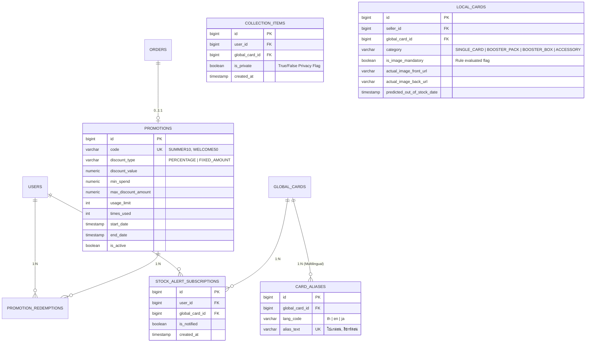

# 📋 Mythix TCG Platform — Phase 2 Extended Requirements & General Enhancements
> **เอกสารข้อกำหนดความต้องการและ User Stories เพิ่มเติมประจำ Phase 2 (Non-Auction Core & Course Requirements)**  
> **Repository:** `User-FlowANDFigma-Progress`  
> **Branch:** `main`  
> **ต่อยอดจาก:** Mythix TCG Platform Phase 1 Baseline (`US-01` ถึง `US-12`) และ Phase 2 Auction Specification (`US-13` ถึง `US-19`)  
> **วันจัดทำ:** พฤศจิกายน 2026  

---

## 📑 สารบัญ (Table of Contents)
1. [บทนำและภาพรวมของเอกสาร (Overview)](#1-บทนำและภาพรวมของเอกสาร-overview)
2. [ตารางสรุปความสัมพันธ์ของ Requirements กับ User Stories และการแบ่ง Phase (Traceability Matrix)](#2-ตารางสรุปความสัมพันธ์ของ-requirements-กับ-user-stories-และการแบ่ง-phase-traceability-matrix)
3. [รายละเอียดเชิงลึกของ User Stories แยกตามหมวดหมู่ (US-20 ถึง US-28)](#3-รายละเอียดเชิงลึกของ-user-stories-แยกตามหมวดหมู่-us-20-ถึง-us-28)
   - [หมวด US-20: ระบบรูปภาพและเกณฑ์การบังคับใส่ภาพถ่ายจริง (Card Image Upload Policy & Criteria)](#หมวด-us-20-ระบบรูปภาพและเกณฑ์การบังคับใส่ภาพถ่ายจริง-card-image-upload-policy--criteria)
   - [หมวด US-21: ค่าบริการตัวกลางและแดชบอร์ดยอดขายรายเดือน (Middleman Escrow Fee & Monthly Dashboard)](#หมวด-us-21-ค่าบริการตัวกลางและแดชบอร์ดยอดขายรายเดือน-middleman-escrow-fee--monthly-dashboard)
   - [หมวด US-22: การตั้งค่าความเป็นส่วนตัวและการชมคอลเลกชันผู้อื่น (Collection Privacy & Showcase Viewer)](#หมวด-us-22-การตั้งค่าความเป็นส่วนตัวและการชมคอลเลกชันผู้อื่น-collection-privacy--showcase-viewer)
   - [หมวด US-23: หมวดหมู่สินค้าและตัวกรองขั้นสูง (Product Categories & Advanced Filtering)](#หมวด-us-23-หมวดหมู่สินค้าและตัวกรองขั้นสูง-product-categories--advanced-filtering)
   - [หมวด US-24: ระบบโปรโมชันและโค้ดส่วนลด (Promotions & Discount Codes Engine)](#หมวด-us-24-ระบบโปรโมชันและโค้ดส่วนลด-promotions--discount-codes-engine)
   - [หมวด US-25: การสั่งซื้อซ้ำและพิมพ์สรุปออเดอร์เป็น PDF (1-Click Reorder & PDF Summary Export)](#หมวด-us-25-การสั่งซื้อซ้ำและพิมพ์สรุปออเดอร์เป็น-pdf-1-click-reorder--pdf-summary-export)
   - [หมวด US-26: ระบบแจ้งเตือนสินค้าหมดและการทำนายสต๊อก (Out-of-Stock Alert & Smart Restock Prediction)](#หมวด-us-26-ระบบแจ้งเตือนสินค้าหมดและการทำนายสต๊อก-out-of-stock-alert--smart-restock-prediction)
   - [หมวด US-27: รายงานสรุปสต๊อกและกำไรรายสัปดาห์สำหรับแอดมิน (Weekly Stock & Profit Admin Report)](#หมวด-us-27-รายงานสรุปสต๊อกและกำไรรายสัปดาห์สำหรับแอดมิน-weekly-stock--profit-admin-report)
   - [หมวด US-28: ระบบค้นหาทนทานต่อคำผิดและค้นหาหลายภาษา (Tolerant & Multilingual Search Engine)](#หมวด-us-28-ระบบค้นหาทนทานต่อคำผิดและค้นหาหลายภาษา-tolerant--multilingual-search-engine)
4. [การต่อขยายโครงสร้างฐานข้อมูล (Database Schema Extension)](#4-การต่อขยายโครงสร้างฐานข้อมูล-database-schema-extension)

---

## 1. บทนำและภาพรวมของเอกสาร (Overview)

เอกสารฉบับนี้จัดทำขึ้นเพื่อรวบรวมและกำหนดสเปกของ **Requirements เพิ่มเติมใน Phase 2** ซึ่งประกอบด้วย:
1. **ข้อกำหนดเฉพาะทางธุรกิจของระบบ (Custom Business Requirements):** ระบบเกณฑ์บังคับรูปภาพ, ระบบค่าธรรมเนียมคนกลาง, แดชบอร์ดยอดขายรายเดือน, และระบบ Public/Private Collection พร้อมหน้าดูคอลเลกชันของคนอื่น
2. **ข้อกำหนดตามโจทย์บังคับและคะแนนโบนัสของหลักสูตร (Course-Mandated Phase 2 Requirements):** หมวดหมู่สินค้า, ระบบโค้ดส่วนลด, การสั่งซื้อซ้ำ (Reorder), การพิมพ์ออเดอร์เป็น PDF, ระบบแจ้งเตือนของหมด, รายงานสรุปรายสัปดาห์สำหรับแอดมิน, ระบบค้นหาแบบทนทานคำผิด (Typo-Tolerant Search เช่น "pokamon" → "pokemon"), ค้นหาข้ามภาษาไทย-อังกฤษ ("โปเกมอน" → "Pokemon"), และระบบ AI ทำนายสต๊อกล่วงหน้า (Smart Restock Prediction)

---

## 2. ตารางสรุปความสัมพันธ์ของ Requirements กับ User Stories และการแบ่ง Phase (Traceability Matrix)

ตารางด้านล่างแสดงการเชื่อมโยงความต้องการทั้งหมดเข้ากับ User Story ID, การอ้างอิงฟังก์ชันเดิมใน Phase 1 และระบุสถานะว่าส่วนใดทำแล้วใน Phase 1 และส่วนใดจะพัฒนาเพิ่มใน Phase 2:

| ที่ | หัวข้อ Requirement | รายละเอียดโดยย่อ | รหัส User Story (US ID) | เฟสที่ดำเนินการ (Phase Implementation) | อ้างอิงความเชื่อมโยงกับ Phase 1 (Phase 1 Reference) |
| :---: | :--- | :--- | :---: | :---: | :--- |
| **1** | **ระบบรูปภาพและเกณฑ์การบังคับ** | กำหนดเกณฑ์บังคับใส่รูปถ่ายจริง (การ์ดแพง, การ์ดเกรด, การ์ดมีตำหนิ) vs ตัวเลือกเสริม (การ์ดคอมมอน/ราคาถูก) | `US-20-1` `US-20-2` | **Phase 2** *(ขยายผลจาก Phase 1)* | ต่อยอดจาก `US-05-1` (Add Product Listing เดิมที่ให้ลงรูปได้ แต่ยังไม่มีระบบเกณฑ์บังคับตรวจเช็ก) |
| **2** | **ระบบเก็บเงินค่าตัวกลาง (Escrow/Fee)** | หักค่าธรรมเนียมแพลตฟอร์มในการเป็นตัวกลางตรวจสอบและคุ้มครองการซื้อขาย | `US-21-1` | **Phase 2** | ใน Phase 1 ออกแบบเป็น Contact Handoff ฟรี (`US-04-1`) Phase 2 เพิ่มระบบคำนวณหักค่าตัวกลางในกระบวนการ Settlement |
| **3** | **แดชบอร์ดแสดงยอดขายต่อเดือน** | สรุปยอดขายรวม ต้นทุน กำไรสุทธิ และจำนวนออเดอร์ แบบแบ่งรายเดือน (Monthly Metrics) | `US-21-2` | **Phase 2** *(ขยายผลจาก Phase 1)* | ต่อยอดจาก `US-06-1` (เดิมดูยอดสะสมรวม ไม่ได้จัดกลุ่มตามปฏิทินรายเดือน) |
| **4** | **Public & Private Collection** | ปุ่มสลับสถานะอัลบั้มสะสมเป็นสาธารณะ (ทุกคนดูได้) หรือส่วนตัว (เห็นเฉพาะเจ้าของ) | `US-22-1` | **Phase 2** *(ขยายผลจาก Phase 1)* | ต่อยอดจาก `US-10-1` (Personal Binder เดิมที่มีอยู่แล้ว เพิ่มฟิลด์ความเป็นส่วนตัว `is_public`) |
| **5** | **หน้าดู Collection คนอื่น** | หน้าเว็บชมอัลบั้มการ์ดสะสมของนักสะสมท่านอื่น พร้อมฟังก์ชันค้นหา เปรียบเทียบ และสถิติ | `US-22-2` | **Phase 1 มีพื้นฐานแล้ว** *(ขยาย UI ใน Phase 2)* | อ้างอิงจาก `US-10-6` (Public Collector Showcase & Leaderboard เดิมที่มี Route `/collections/:userId`) |
| **6** | **Product Categories & Filters** | แยกหมวดหมู่ประเภทสินค้า (Single Card, Booster Pack, Booster Box, Accessories) พร้อมตัวกรอง | `US-23-1` | **Phase 1 มีบางส่วนแล้ว** *(ขยายใน Phase 2)* | Phase 1 มี Multi-filter (`US-02-1`) กรองเซ็ตการ์ด/ความหายาก ใน Phase 2 เพิ่มระดับ Category ใหญ่และอุปกรณ์เสริม |
| **7** | **Promotions / Discount Codes** | ระบบกรอกโค้ดส่วนลดโปรโมชันในขั้นตอน Checkout (ลดเป็น % หรือลดเงินสด) | `US-24-1` | **Phase 2** *(ฟีเจอร์ใหม่)* | ไม่มีใน Phase 1 พัฒนาเป็นระบบใหม่เชื่อมต่อกับ Checkout Flow (`US-04-1`) |
| **8** | **Order History & Reorder Option** | ดูประวัติคำสั่งซื้อ และมีปุ่มคลิกเดียว "สั่งซื้อซ้ำ (Reorder)" ดึงสินค้าเดิมเข้าสั่งซื้อใหม่ | `US-25-1` | **Phase 1 มีประวัติแล้ว** *(Reorder ทำใน Phase 2)* | ดูประวัติออเดอร์ทำแล้วใน `US-09-1`, `US-09-2` ส่วนปุ่มสั่งซื้อซ้ำ (Reorder Option) พัฒนาเพิ่มใน Phase 2 |
| **9** | **Print/Save Order Summary as PDF** | ปุ่มกดดาวน์โหลดหรือพิมพ์ใบสรุปรายการคำสั่งซื้อ / ใบเสร็จรับเงินเป็นไฟล์ PDF | `US-25-2` | **Phase 2** *(ฟีเจอร์ใหม่)* | ไม่มีใน Phase 1 นำข้อมูลจาก Order History (`US-09-1`) มาเรนเดอร์ PDF Template |
| **10** | **Out of Stock Alert System (In-App & Email)** | แจ้งเตือนผู้ขายเมื่อสต๊อกสินค้าหมด และแจ้งเตือนผู้ซื้อเมื่อสินค้าที่สนใจกลับมามีสต๊อก (Back-in-stock) ทั้ง In-App และ Email Notification | `US-26-1` | **Phase 2** *(ขยายผลจาก Phase 1)* | ต่อยอดจากระบบแจ้งเตือน In-App Notification (`US-11-1`) ของ Phase 1 ร่วมกับระบบส่งอีเมล |
| **11** | **Weekly Stock/Profit Report for Admins** | รายงานวิเคราะห์สต๊อกสินค้าคงคลังและผลกำไรประจำสัปดาห์สำหรับผู้ดูแลระบบ | `US-27-1` | **Phase 2** *(ขยายผลจาก Phase 1)* | ต่อยอดจาก Admin Dashboard (`US-12-1`) ของ Phase 1 โดยเพิ่ม Scheduled Weekly Batch Report |
| **12** | **Tolerant Search (Typo Tolerance)** | ระบบค้นหาอัจฉริยะที่ยอมรับคำพิมพ์ผิด/สะกดผิดเล็กน้อย เช่น ค้นหา "pokamon" ผลลัพธ์แสดง "pokemon" | `US-28-1` | **Phase 2** *(ฟีเจอร์ใหม่)* | Phase 1 เป็น `LIKE/ILIKE` ปกติ (`US-02-1`) Phase 2 เปลี่ยนเป็น Fuzzy Search (Trigram / Levenshtein) |
| **13** | **[Bonus a] Multilingual Search (TH/EN)** | ค้นหาชื่อการ์ดเป็นภาษาไทยแล้วพบการ์ดภาษาอังกฤษ เช่น ค้นหา "โปเกมอน" ผลลัพธ์แสดง "Pokemon" | `US-28-2` | **Phase 2** *(โบนัสพิเศษ)* | ฟังก์ชันส่วนขยายของระบบสืบค้นในแคตตาล็อกกลาง (`US-02-1`) |
| **14** | **[Bonus b] Smart Restock Prediction** | ระบบวิเคราะห์แนวโน้มยอดขายและทำนายวันที่สินค้าจะหมดสต๊อกล่วงหน้า | `US-26-2` | **Phase 2** *(โบนัสพิเศษ)* | เชื่อมโยงกับระบบคำนวณสต๊อกใน Seller Dashboard (`US-06-1`) |

---

## 3. รายละเอียดเชิงลึกของ User Stories แยกตามหมวดหมู่ (US-20 ถึง US-28)

---

### หมวด US-20: ระบบรูปภาพและเกณฑ์การบังคับใส่ภาพถ่ายจริง (Card Image Upload Policy & Criteria)

#### 🔹 US-20-1: Mandatory vs. Optional Real Card Image Upload Gate
* **User Story:**  
  *ในฐานะผู้ขาย (Verified Seller)*  
  *ฉันต้องการให้ระบบมีเกณฑ์และแจ้งเตือนอย่างชัดเจนว่าการ์ดแบบใดต้องบังคับอัปโหลดภาพถ่ายจริง และการ์ดแบบใดสามารถใช้ภาพจากแคตตาล็อกกลางได้*  
  *เพื่อความโปร่งใส ป้องกันข้อพิพาทเรื่องสภาพการ์ด และช่วยให้การลงขายการ์ดทั่วไปทำได้อย่างรวดเร็ว*
* **เกณฑ์การตัดสินใจ (Business Criteria Matrix):**
  * **กลุ่มที่ 1: บังคับอัปโหลดภาพถ่ายจริง (Mandatory - อย่างน้อย 2 รูป: ด้านหน้าและด้านหลังความละเอียดสูง):**
    1. **การ์ดที่มีราคาสูง:** รายการขายที่มีราคาตั้งแต่ **500 บาทขึ้นไป**
    2. **การ์ดเกรดทุกใบ (Graded Cards):** มีการระบุสถาบันเกรด (PSA, BGS, CGC) ต้องถ่ายรูปเห็นตลับและเลขทะเบียน (Cert No.) ชัดเจน
    3. **การ์ดที่มีสภาพไม่สมบูรณ์:** การ์ดที่ระบุสภาพเป็น **LP (Lightly Played), MP (Moderately Played), HP (Heavily Played), หรือ DMG (Damaged)** เพื่อแสดงรอยขีดข่วน ขอบขาว หรือรอยพับ
    4. **การ์ดระดับความหายากพิเศษ (High Rarity):** Secret Rare (SR), Special Art Rare (SAR), Alternate Art (Alt-Art), หรือ Promo Card
  * **กลุ่มที่ 2: เป็นตัวเลือกเสริม (Optional - สามารถเลือกใช้ภาพต้นแบบจาก Global Master Catalog ได้):**
    1. การ์ดระดับพื้นฐาน (Common / Uncommon / Regular Rare)
    2. การ์ดสภาพสมบูรณ์ไร้ตำหนิระดับ **Near Mint (NM)**
    3. การ์ดที่มีราคาต่ำกว่า 500 บาท
* **Acceptance Criteria:**
  - [x] ในหน้าแบบฟอร์มลงขายสินค้า (`/seller/products/new`) ระบบจะประเมินข้อมูล ราคา สภาพการ์ด และความหายากแบบ Real-time
  - [x] หากเข้าเกณฑ์ Mandatory ปุ่มส่งฟอร์ม (Submit) จะถูกล็อกจนกว่าจะอัปโหลดรูปจริงด้านหน้าและหลังครบถ้วน พร้อมแสดง Badge สีแดงกำกับ *"จำเป็นต้องแนบภาพถ่ายการ์ดจริง"*
  - [x] หากเป็น Optional ระบบจะตั้งค่าเริ่มต้นเป็นรูปจาก Master Catalog แต่ยังคงมีปุ่มให้อัปโหลดรูปจริงเพิ่มเติมได้ตามความสมัครใจ
  - [x] มีการตรวจสอบความถูกต้องของประเภทไฟล์ (JPG, PNG, WebP) และขนาดไฟล์ไม่เกิน 5MB ต่อรูป
* **API Endpoints:** `POST /api/seller/products/validate-listing-rules`, `POST /api/seller/products/upload-images`

#### 🔹 US-20-2: Zoomable High-Resolution Card Gallery on Detail Page
* **User Story:**  
  *ในฐานะผู้ซื้อ (Customer)*  
  *ฉันต้องการดูรูปถ่ายจริงของการ์ดแบบซูมขยายความละเอียดสูง (Magnifier Zoom)*  
  *เพื่อส่องดูมุม ขอบ และรอยตำหนิของการ์ดใบจริงก่อนตัดสินใจกดสั่งซื้อ*
* **Acceptance Criteria:**
  - [x] หน้ารายละเอียดการ์ดของผู้ขายแต่ละราย มีแท็บสลับระหว่าง "ภาพต้นแบบทางการ (Official Artwork)" กับ "ภาพถ่ายการ์ดจริง (Actual Card Photos)"
  - [x] รองรับการ Hover เพื่อซูมส่องรอยขนแมวและขอบการ์ดในอัตราขยาย 2.5x

---

### หมวด US-21: ค่าบริการตัวกลางและแดชบอร์ดยอดขายรายเดือน (Middleman Escrow Fee & Monthly Dashboard)

#### 🔹 US-21-1: Platform Middleman & Escrow Commission Fee Engine
* **User Story:**  
  *ในฐานะผู้บริหารแพลตฟอร์ม (Platform Admin)*  
  *ฉันต้องการให้ระบบคำนวณและหักค่าธรรมเนียมตัวกลาง (Middleman / Commission Fee) โดยอัตโนมัติจากทุกคำสั่งซื้อที่เสร็จสมบูรณ์*  
  *เพื่อสร้างรายได้สำหรับครอบคลุมค่าใช้จ่ายในการดำเนินงาน การตรวจสอบคุณภาพการ์ด (QC) และการประกันความเสียหาย*
* **Acceptance Criteria:**
  - [x] แอดมินสามารถกำหนดอัตราค่าธรรมเนียมตัวกลางได้ผ่านระบบหลังบ้าน (เช่น 3% หรือ 5% ของยอดสั่งซื้อ โดยกำหนดขั้นต่ำ 20 บาท)
  - [x] ในหน้าสรุปคำสั่งซื้อ (Checkout Summary) แสดงแจกแจงยอดเงินชัดเจน: ราคาสินค้า, ค่าจัดส่ง, และค่าบริการตัวกลางคุ้มครองการซื้อขาย
  - [x] เมื่อคำสั่งซื้อเปลี่ยนสถานะเป็น `FULFILLED` ระบบจะตัดยอดสุทธิเข้าบัญชีร้านค้าหลังหักค่าธรรมเนียม และบันทึกรายได้ของแพลตฟอร์มลงตารางบัญชีกลาง
* **API Endpoints:** `GET /api/platform/fee-policy`, `POST /api/admin/system-settings/commission-rate`

#### 🔹 US-21-2: Monthly Sales & Profit Analytics Dashboard
* **User Story:**  
  *ในฐานะผู้ขาย (Verified Seller)*  
  *ฉันต้องการหน้าแดชบอร์ดสรุปยอดขาย ต้นทุน และกำไรสุทธิแบบแบ่งตามรายเดือน (Monthly Breakdown)*  
  *เพื่อวิเคราะห์ผลการดำเนินงานทางธุรกิจ และเปรียบเทียบการเติบโตของยอดขายในแต่ละเดือน*
* **Acceptance Criteria:**
  - [x] เมนู Seller Dashboard เพิ่มแท็บตัวเลือกดูข้อมูลสรุปแบบ **"รายเดือน (Monthly)"** พร้อม Dropdown เลือกเดือนและปี
  - [x] แสดงตัวชี้วัดสำคัญ (Key Metrics):
    1. ยอดขายรวมประจำเดือน (Monthly Gross Revenue)
    2. ต้นทุนสินค้ารวม (Total Cost of Goods Sold)
    3. ค่าธรรมเนียมตัวกลางที่ถูกหัก (Platform Fees Paid)
    4. กำไรสุทธิประจำเดือน (Net Realized Profit)
    5. จำนวนออเดอร์ที่สำเร็จ (Completed Orders Count)
  - [x] แสดงกราฟแท่งเปรียบเทียบยอดขาย 12 เดือนย้อนหลัง
  - [x] รองรับการกด Export สรุปยอดขายประจำเดือนออกมาเป็นไฟล์ CSV
* **API Endpoints:** `GET /api/seller/analytics/monthly?year=2026&month=10`

---

### หมวด US-22: การตั้งค่าความเป็นส่วนตัวและการชมคอลเลกชันผู้อื่น (Collection Privacy & Showcase Viewer)

#### 🔹 US-22-1: Collection Privacy Setting (Public vs. Private)
* **User Story:**  
  *ในฐานะนักสะสม (Collector / User)*  
  *ฉันต้องการตั้งค่าความเป็นส่วนตัวให้กับอัลบั้มสะสมการ์ดของฉันได้ ว่าจะให้แสดงเป็นสาธารณะ (Public) หรือส่วนตัว (Private)*  
  *เพื่อความสบายใจในการจัดการการ์ดสะสมส่วนบุคคล หรือเพื่อป้องกันความเป็นส่วนตัวกรณีครอบครองการ์ดมูลค่าสูงมาก*
* **Acceptance Criteria:**
  - [x] ในหน้า Personal Binder (`/my-collection`) มีสวิตช์ Toggle: **"Public Showcase (เปิดเผยต่อสาธารณะ)"** หรือ **"Private (ส่วนตัว)"**
  - [x] ค่าเริ่มต้นของระบบถูกตั้งเป็น `is_public = true`
  - [x] หากผู้ใช้สลับเป็น `Private` ระบบจะซ่อนอัลบั้มนี้ออกจากตาราง Leaderboard นักสะสม และบล็อกการเข้าชมผ่าน URL สาธารณะ
  - [x] หากผู้ใช้อื่นพยายามเข้าลิงก์อัลบั้มที่เป็น Private ระบบจะแสดงหน้าแจ้งเตือน *"This collection is set to private by the owner"* (HTTP 403 Forbidden)
* **API Endpoints:** `PATCH /api/user/collection/privacy`

#### 🔹 US-22-2: Public Community Collector Showcase Viewer
* **User Story:**  
  *ในฐานะผู้ใช้งานทั่วไปและนักสะสม (Guest / User)*  
  *ฉันต้องการเข้าดูหน้าอัลบั้มการ์ดสะสมของนักสะสมท่านอื่นผ่าน URL หน้ารวม (`/collections/:userId`)*  
  *เพื่อชื่นชมการ์ดหายาก ดูแรงบันดาลใจในการสะสม และเปรียบเทียบการ์ดที่ตนเองมีกับของเพื่อนนักสะสม*
* **Acceptance Criteria:**
  - [x] หน้าเว็บ Showcase แสดงข้อมูลโปรไฟล์นักสะสม: ชื่อ, Avatar, จำนวนการ์ดทั้งหมด, จำนวนการ์ดระดับ Secret Rare, และตราเกียรติยศ (Badges)
  - [x] มีช่องค้นหาและตัวกรองภายในอัลบั้ม: กรองตามชื่อการ์ด, ชุดการ์ด, และระดับความหายาก
  - [x] **ฟังก์ชัน Card Comparison Helper:** หากผู้เยี่ยมชมเข้าสู่ระบบอยู่ จะมีป้ายบอกในการ์ดแต่ละใบว่า *"คุณครอบครองการ์ดใบนี้แล้ว X ใบ"* หรือ *"คุณยังไม่มีการ์ดใบนี้"*
  - [x] มีปุ่ม "แชร์อัลบั้ม (Share Collection Link)" สำหรับคัดลอก URL นำไปแชร์บน Social Media
* **API Endpoints:** `GET /api/public/collections/{userId}`, `GET /api/public/collections/{userId}/compare`

---

### หมวด US-23: หมวดหมู่สินค้าและตัวกรองขั้นสูง (Product Categories & Advanced Filtering)

#### 🔹 US-23-1: Multi-Tier Product Category Architecture & Facet Filters
* **User Story:**  
  *ในฐานะผู้ซื้อ (Customer / Guest)*  
  *ฉันต้องการค้นหาและเลือกดูสินค้าแยกตามประเภทหมวดหมู่หลัก (Single Card, Booster Pack, Booster Box, Accessories)*  
  *เพื่อจำแนกประเภทสินค้าได้อย่างแม่นยำ ไม่สับสนระหว่างการ์ดเดี่ยวกับกล่องสุ่มหรือซองใส่การ์ด*
* **Acceptance Criteria:**
  - [x] หน้า Catalog เพิ่มหมวดหมู่หลักระดับสากล 4 ประเภท:
    1. **Single Cards (การ์ดเดี่ยว):** มีตัวกรองสภาพ (NM-DMG), ภาษา, และสถาบันเกรด
    2. **Booster Packs (ซองสุ่ม):** ซองบรรจุการ์ดแบบปิดผนึก (Sealed Pack)
    3. **Booster Boxes (กล่องการ์ด):** กล่องซีลแท้จากผู้ผลิต
    4. **Accessories (อุปกรณ์สะสม):** แฟ้มใส่การ์ด (Binder), ซองการ์ด (Sleeves), กรอบแม่เหล็ก (Toploader), และตลับอะคริลิก
  - [x] เมนู Navigation Bar ด้านบนมี Dropdown เมนูหมวดหมู่สินค้าให้กดเลือกโดยตรง
  - [x] ตัวกรองทางด้านซ้ายจะปรับเปลี่ยนแบบ Dynamic ตามหมวดหมู่ที่เลือก (Context-Aware Filters)
* **API Endpoints:** `GET /api/categories`, `GET /api/products?category=BOOSTER_BOX`

---

### หมวด US-24: ระบบโปรโมชันและโค้ดส่วนลด (Promotions & Discount Codes Engine)

#### 🔹 US-24-1: Voucher Promo Code Application at Checkout
* **User Story:**  
  *ในฐานะผู้ซื้อ (Customer)*  
  *ฉันต้องการกรอกโค้ดส่วนลดโปรโมชันในหน้า Checkout เพื่อรับส่วนลดราคาสินค้าหรือส่วนลดค่าบริการ*  
  *เพื่อประหยัดค่าใช้จ่ายและได้รับสิทธิประโยชน์จากแคมเปญส่งเสริมการขายของแพลตฟอร์ม*
* **Acceptance Criteria:**
  - [x] ในหน้า Checkout สรุปรายการสั่งซื้อ มีช่องกรอก **"Discount Code"** พร้อมปุ่ม "Apply"
  - [x] ระบบรองรับส่วนลด 2 รูปแบบ:
    1. **Percentage Discount (ลดเป็นเปอร์เซ็นต์):** เช่น ลด 10% (มีเพดานลดสูงสุด เช่น ไม่เกิน 200 บาท)
    2. **Fixed Amount Discount (ลดเงินสด):** เช่น ลดทันที 50 บาท เมื่อยอดสั่งซื้อขั้นต่ำครบ 500 บาท
  - [x] มีการตรวจสอบเงื่อนไขความถูกต้อง (Validation Rules):
    - โค้ดยังไม่หมดอายุ (`start_date <= NOW() <= end_date`)
    - ยอดสั่งซื้อถึงเกณฑ์ขั้นต่ำ (`min_spend`)
    - สิทธิ์การใช้ยังไม่เต็มจำนวนจำกัด (`usage_limit > current_usage`)
    - ผู้ใช้ 1 คนสามารถใช้โค้ดนั้นได้ตามจำนวนครั้งที่ระบุ (เช่น 1 ครั้งต่อบัญชี)
  - [x] เมื่อโค้ดถูกต้อง ยอดรวมจะถูกคำนวณใหม่ทันที และแสดงแถว "Discount: -฿XX" ก่อนยืนยันการสั่งซื้อ
* **API Endpoints:** `POST /api/promotions/validate-code`, `POST /api/orders/apply-promo`

---

### หมวด US-25: การสั่งซื้อซ้ำและพิมพ์สรุปออเดอร์เป็น PDF (1-Click Reorder & PDF Summary Export)

#### 🔹 US-25-1: 1-Click Fast Reorder Flow from Order History
* **User Story:**  
  *ในฐานะผู้ซื้อ (Customer)*  
  *ฉันต้องการกดปุ่ม "สั่งซื้อซ้ำ (Reorder)" จากรายการคำสั่งซื้อเดิมในอดีต*  
  *เพื่อนำสินค้าชุดเดิมใส่เข้าตะกร้าสินค้าทันทีโดยไม่ต้องเสียเวลาค้นหาการ์ดทีละใบใหม่*
* **Acceptance Criteria:**
  - [x] ในหน้ารายละเอียดประวัติการสั่งซื้อ (`/orders/:orderId`) มีปุ่มเด่นชัด **"Reorder (สั่งซื้อซ้ำ)"**
  - [x] เมื่อกดปุ่ม ระบบจะตรวจสอบสต๊อกพร้อมขายปัจจุบันของสินค้าในออเดอร์นั้น:
    - **กรณีสินค้ายังมีสต๊อกครบ:** ดึงสินค้าทั้งหมดเข้า Shopping Cart ทันที และพาไปยังหน้าตะกร้าสินค้า
    - **กรณีสินค้าบางรายการหมดสต๊อก:** ระบบจะนำเฉพาะรายการที่มีสต๊อกเข้าตะกร้า และแสดง Modal แจ้งเตือนรายการที่หมด
    - **กรณีสินค้าหมดทุกรายการ:** แจ้งเตือนผู้ใช้ว่าสินค้าในรายการนี้หมดสต๊อกในขณะนี้
* **API Endpoints:** `POST /api/orders/{orderId}/reorder`

#### 🔹 US-25-2: Generate & Print Order Invoice/Summary as PDF
* **User Story:**  
  *ในฐานะผู้ซื้อและผู้ขาย (Customer / Seller)*  
  *ฉันต้องการดาวน์โหลดหรือพิมพ์เอกสารสรุปคำสั่งซื้อเป็นไฟล์ PDF มาตรฐาน*  
  *เพื่อใช้เป็นหลักฐานการสั่งซื้อ ใบปะหน้าพัสดุ หรือเอกสารอ้างอิงในการตรวจสอบและจัดทำบัญชี*
* **Acceptance Criteria:**
  - [x] มีปุ่ม **"Download PDF Invoice"** ในหน้าแสดงรายละเอียดคำสั่งซื้อ
  - [x] เอกสาร PDF ประกอบด้วยข้อมูลครบถ้วน:
    - เลขที่คำสั่งซื้อ (Order Number) และวันที่สั่งซื้อ
    - ข้อมูลผู้ซื้อ และข้อมูลผู้ขาย (ชื่อ, ช่องทางติดต่อ)
    - รายการสินค้า สภาพการ์ด ภาษา จำนวน ราคาต่อหน่วย และยอดรวม
    - แจกแจงส่วนลด ค่าบริการตัวกลาง และยอดชำระสุทธิ
    - QR Code สำหรับสแกนตรวจสอบสถานะออเดอร์บนแพลตฟอร์ม
  - [x] การสร้างเอกสาร PDF ทำงานฝั่ง Backend หรือ Client-side library (เช่น PDFMake / iText) ได้อย่างรวดเร็วภายใน 2 วินาที
* **API Endpoints:** `GET /api/orders/{orderId}/invoice-pdf`

---

### หมวด US-26: ระบบแจ้งเตือนสินค้าหมดและการทำนายสต๊อก (Out-of-Stock Alert & Smart Restock Prediction)

#### 🔹 US-26-1: Out of Stock Alert & Back-in-Stock Multi-Channel Notification (In-App & Email)
* **User Story:**  
  *ในฐานะผู้ขายและผู้ซื้อ (Seller / Buyer)*  
  *ฉันต้องการรับการแจ้งเตือนผ่านทั้งระบบในแอปพลิเคชัน (In-App Notification) และผ่านทางอีเมล (Email Notification) เมื่อสินค้าในร้านหมดสต๊อก หรือเมื่อสินค้าที่ฉันสนใจกลับมามีสต๊อกพร้อมจำหน่ายใหม่*  
  *เพื่อช่วยให้ผู้ขายเติมสินค้าเข้าคลังได้ทันท่วงที และผู้ซื้อไม่พลาดโอกาสในการสั่งซื้อการ์ดใบที่ต้องการ แม้ไม่ได้เปิดหน้าเว็บไซต์อยู่ ณ ขณะนั้น*
* **Acceptance Criteria:**
  - [x] **ฝั่งผู้ขาย (Low/Out of Stock Alert via In-App & Email):**
    - เมื่อสต๊อกการ์ดของผู้ขายในร้านเหลือ 0 ใบ ระบบจะสร้าง In-App Notification แจ้งเตือนในระบบทันที *"การ์ด [ชื่อการ์ด] ของคุณในสต๊อกหมดลงแล้ว กรุณาเติมสต๊อก"*
    - ระบบส่ง **Email แจ้งเตือนไปยังอีเมลของผู้ขายที่ลงทะเบียนไว้** ระบุรายละเอียดชื่อการ์ด, รหัสสินค้า, วันเวลาที่สินค้าหมด และมีปุ่มลิงก์ *"Manage Inventory"* ให้ผู้ขายกดเข้าสู่หน้าจัดการสต๊อกได้โดยตรง
  - [x] **ฝั่งผู้ซื้อ (Notify Me When in Stock via In-App & Email):**
    - สำหรับการ์ดที่สินค้าหมดสต๊อก (Out of Stock) ผู้ซื้อสามารถกดปุ่ม **"Notify Me When Available"** บนหน้ารายละเอียดการ์ดเพื่อเปิดใช้งานการติดตามสินค้า
    - ระบบแสดงหน้าต่างยืนยันการรับแจ้งเตือน โดยใช้อีเมลที่ผูกกับบัญชีผู้ใช้ หรืออนุญาตให้ระบุอีเมลปลายทางที่ต้องการรับแจ้งเตือนได้ พร้อมตัวเลือกเปิด/ปิดรับอีเมล
    - เมื่อมีผู้ขายรายใดลงขายการ์ดรุ่นดังกล่าวเพิ่มเข้าสู่ระบบ (Restocked):
      1. ระบบส่ง **In-App Notification** ไปยังกล่องข้อความแจ้งเตือนของผู้ซื้อทันที
      2. ระบบส่ง **Email แจ้งเตือนสินค้ากลับมามีสต๊อก (Back-in-Stock Email Alert)** ไปยังอีเมลของผู้ซื้อ ระบุชื่อการ์ด, รูปภาพ, สภาพการ์ด, ราคาเริ่มต้น และมีปุ่ม *"Buy Now"* / *"View Listing"* ให้ผู้ซื้อคลิกเพื่อเข้าสู่หน้าสั่งซื้อการ์ดได้ทันที
  - [x] **การจัดการการรับแจ้งเตือน (Subscription Preferences & Unsubscribe):**
    - ในทุกอีเมลแจ้งเตือนสต๊อกจะมีลิงก์ **"Unsubscribe"** ด้านล่างเพื่อให้ผู้ใช้ยกเลิกการติดตามการ์ดใบดังกล่าวได้โดยตรงจากอีเมล
    - มีตัวเลือกในหน้าโปรไฟล์ผู้ใช้ (Notification Settings) สำหรับเปิด/ปิดการรับการแจ้งเตือนประเภท Email Alerts แยกจาก In-App Alerts
* **API Endpoints:** 
  - `POST /api/products/{id}/stock-subscription` (กดติดตามการ์ดที่หมดสต๊อก พร้อมระบุ payload `{ "email": "user@example.com", "notifyEmail": true }`)
  - `DELETE /api/products/{id}/stock-subscription` (ยกเลิกการติดตามการ์ด)
  - `GET /api/user/stock-subscriptions` (ดึงรายการการ์ดที่ผู้ซื้อกดติดตามแจ้งเตือนสต๊อกไว้)
  - `GET /api/seller/inventory/stock-alerts` (ดึงรายการแจ้งเตือนสต๊อกสินค้าหมดของผู้ขาย)

#### 🔹 US-26-2: [Bonus b] Smart Restock Prediction based on Sales Trends
* **User Story:**  
  *ในฐานะผู้ขาย (Verified Seller)*  
  *ฉันต้องการให้ระบบช่วยวิเคราะห์แนวโน้มยอดขายและทำนายวันที่สินค้าจะหมดสต๊อกล่วงหน้า (Restock Prediction)*  
  *เพื่อวางแผนจัดหาการ์ดมาเติมสต๊อกได้อย่างแม่นยำ ไม่เกิดภาวะสินค้าขาดมือ*
* **Acceptance Criteria:**
  - [x] ระบบนำสถิติความเร็วในการขาย (Sales Velocity: จำนวนชิ้นที่ขายได้ต่อวัน ในช่วง 7-30 วันที่ผ่านมา) มาคำนวณเปรียบเทียบกับสต๊อกปัจจุบัน
  - [x] สูตรการทำนายพื้นฐาน: $\text{Days Until Out of Stock} = \frac{\text{Current Stock On-Hand}}{\text{Average Daily Sales Rate}}$
  - [x] ในหน้าคลังสินค้าของผู้ขาย แสดงป้ายแจ้งเตือนอัจฉริยะ เช่น:
    - 🔴 *"คาดว่าจะหมดสต๊อกภายใน 3 วัน"* (เมื่อวันคงเหลือ <= 3 วัน)
    - 🟡 *"คาดว่าจะหมดสต๊อกภายใน 7 วัน"*
  - [x] มีกราฟพยากรณ์ความต้องการ (Demand Trend Forecast) ประกอบการตัดสินใจ
* **API Endpoints:** `GET /api/seller/inventory/restock-predictions`

---

### หมวด US-27: รายงานสรุปสต๊อกและกำไรรายสัปดาห์สำหรับแอดมิน (Weekly Stock & Profit Admin Report)

#### 🔹 US-27-1: Automated Weekly Stock & Profit Platform Governance Report
* **User Story:**  
  *ในฐานะผู้ดูแลระบบ (Platform Admin)*  
  *ฉันต้องการรายงานสรุปภาพรวมสินค้าคงคลัง ความเคลื่อนไหวของสต๊อก และผลกำไรประจำสัปดาห์ของทั้งแพลตฟอร์ม*  
  *เพื่อใช้กำกับดูแลความเสี่ยง ติดตามมูลค่าทางเศรษฐกิจ และประเมินสุขภาพทางการเงินของแพลตฟอร์ม*
* **Acceptance Criteria:**
  - [x] ระบบมี Scheduled Job ทำงานอัตโนมัติทุกวันอาทิตย์ เวลา 23:59 UTC เพื่อรวบรวมข้อมูลประจำสัปดาห์
  - [x] รายงานประจำสัปดาห์สรุปข้อมูล 4 มิติ:
    1. **Stock Movement:** สินค้าใหม่ที่ลงขาย, สินค้าที่ขายออกไปแล้ว, และมูลค่าสต๊อกคงเหลือรวมในระบบ (Total Inventory Value)
    2. **Profit & Fees:** รายได้ค่าธรรมเนียมตัวกลางรวมของแพลตฟอร์มในรอบสัปดาห์
    3. **Top Performing Cards:** 10 อันดับการ์ดที่มียอดขายสูงสุดและกำไรสูงสุด
    4. **Stagnant Inventory:** สินค้าที่ค้างสต๊อกเกินกว่า 60 วันโดยไม่มีการเคลื่อนไหว
  - [x] แอดมินสามารถเปิดดูรายงานย้อนหลังในเมนู Admin Console และกดดาวน์โหลดเป็นรายงาน Excel / CSV หรือ PDF ได้
* **API Endpoints:** `GET /api/admin/reports/weekly-summary`, `GET /api/admin/reports/weekly-summary/export`

---

### หมวด US-28: ระบบค้นหาทนทานต่อคำผิดและค้นหาหลายภาษา (Tolerant & Multilingual Search Engine)

#### 🔹 US-28-1: Typo-Tolerant Fuzzy Search Functionality
* **User Story:**  
  *ในฐานะผู้ใช้งาน (Guest / Customer)*  
  *ฉันต้องการค้นหาชื่อการ์ดแล้วพบผลลัพธ์ที่ถูกต้อง แม้ว่าฉันจะพิมพ์คำค้นหาสะกดผิดเล็กน้อย ตกหล่น หรือสลับตัวอักษร (เช่น พิมพ์ "pokamon" แต่ระบบเข้าใจและแสดงผลลัพธ์ของ "pokemon")*  
  *เพื่อความสะดวกรวดเร็วในการค้นหา และไม่พลาดสินค้าเพียงเพราะสะกดชื่อการ์ดภาษาอังกฤษผิด*
* **Acceptance Criteria:**
  - [x] ระบบค้นหารองรับการคำนวณความคล้ายคลึงของข้อความ (Fuzzy String Matching) โดยใช้เกณฑ์ Levenshtein Distance หรือ PostgreSQL `pg_trgm` (Trigram Similarity)
  - [x] เมื่อคำค้นหาผิดพลาดไม่เกิน 2 ตัวอักษร (Edit Distance <= 2) ระบบจะส่งคืนการ์ดที่ใกล้เคียงที่สุดได้ถูกต้อง เช่น:
    - พิมพ์ `"pokamon"` → แสดงการ์ด `"Pokemon"`
    - พิมพ์ `"chairzard"` → แสดงการ์ด `"Charizard"`
    - พิมพ์ `"pikashu"` → แสดงการ์ด `"Pikachu"`
  - [x] หน้าผลลัพธ์การค้นหาแสดงข้อความแนะนำที่เป็นมิตร: *"แสดงผลลัพธ์สำหรับ: **Pokemon** (แทนคำค้นหาเดิม 'pokamon')"* พร้อมมีลิงก์ให้กดค้นหาตามคำเดิมได้
* **API Endpoints:** `GET /api/cards/search?q=pokamon&fuzzy=true`

#### 🔹 US-28-2: [Bonus a] Multilingual Cross-Script Search (Thai & English)
* **User Story:**  
  *ในฐานะนักสะสมชาวไทย (Thai Collector)*  
  *ฉันต้องการพิมพ์คำค้นหาชื่อการ์ดเป็นภาษาไทย แล้วให้ระบบแสดงผลลัพธ์การ์ดภาษาอังกฤษที่ถูกต้องตรงกันได้ (เช่น ค้นหาคำว่า "โปเกมอน" แล้วแสดงผลการ์ด Pokemon ทั้งหมด)*  
  *เพื่อความสะดวกสบายของผู้เล่นไทยที่ไม่ทราบการสะกดชื่อเฉพาะภาษาอังกฤษของการ์ดแต่ละใบ*
* **Acceptance Criteria:**
  - [x] ตารางแคตตาล็อกการ์ด (`global_cards`) มีการผูกตารางพจนานุกรมชื่อภาษาไทยและชื่อเรียกทางการ (`card_translations` หรือฟิลด์ `search_aliases`)
  - [x] ตัวอย่างคำค้นหาที่ต้องรองรับอย่างถูกต้อง:
    - ค้นหา `"โปเกมอน"` หรือ `"โปเกบอล"` → แสดงผลการ์ด `"Pokemon"` / `"Poke Ball"`
    - ค้นหา `"ลิซาร์ดอน"` → แสดงผลการ์ด `"Charizard"`
    - ค้นหา `"มิว"` หรือ `"มิวทู"` → แสดงผลการ์ด `"Mew"` / `"Mewtwo"`
    - ค้นหา `"พิคาชู"` หรือ `"ปิกาจู"` → แสดงผลการ์ด `"Pikachu"`
  - [x] ระบบค้นหารองรับการค้นหาแบบผสม (Hybrid Search): ค้นหาภาษาไทย + หมายเลขการ์ด เช่น `"ลิซาร์ดอน 006"` ก็สามารถค้นหาพบได้อย่างถูกต้อง
* **API Endpoints:** `GET /api/cards/search?q=โปเกมอน`

---

## 4. การต่อขยายโครงสร้างฐานข้อมูล (Database Schema Extension)

เพื่อรองรับฟีเจอร์เพิ่มเติมในเอกสารชุดนี้ ตารางฐานข้อมูลเดิมของ Mythix TCG Platform จะได้รับการเพิ่มฟิลด์และตารางสนับสนุนใหม่ดังนี้:

---
> 📌 *เอกสารฉบับนี้เป็นส่วนเสริมสมบูรณ์ของ Phase 2 ในโครงการ Mythix TCG Platform จัดเก็บอยู่ใน repository `User-FlowANDFigma-Progress` ตามมาตรฐานความต้องการของทีมและหลักสูตร*
