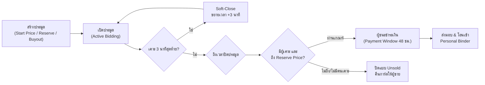
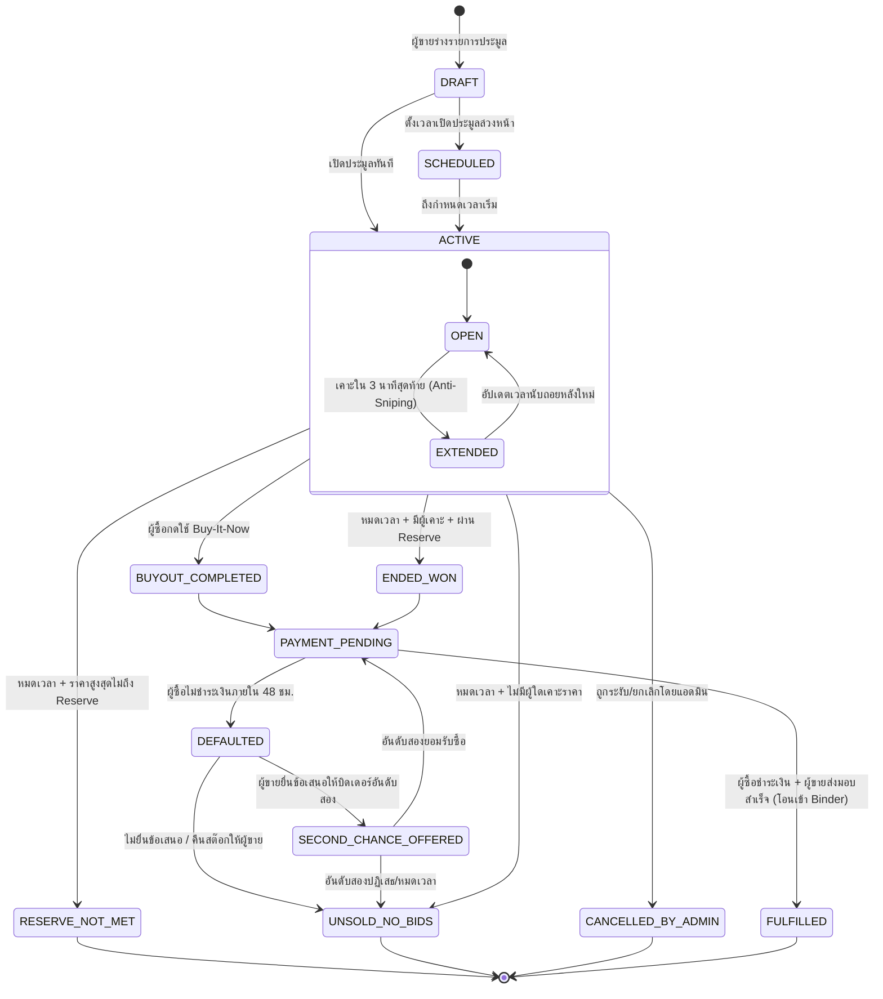
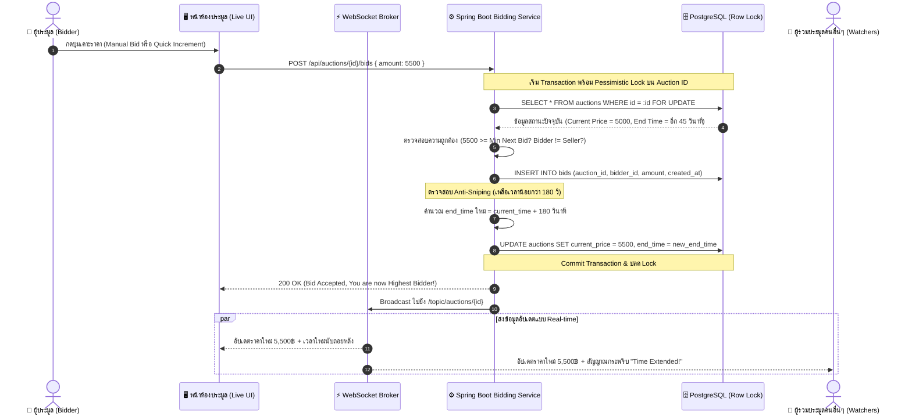
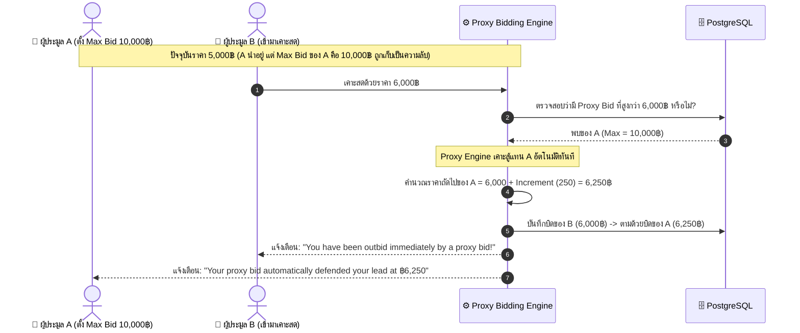
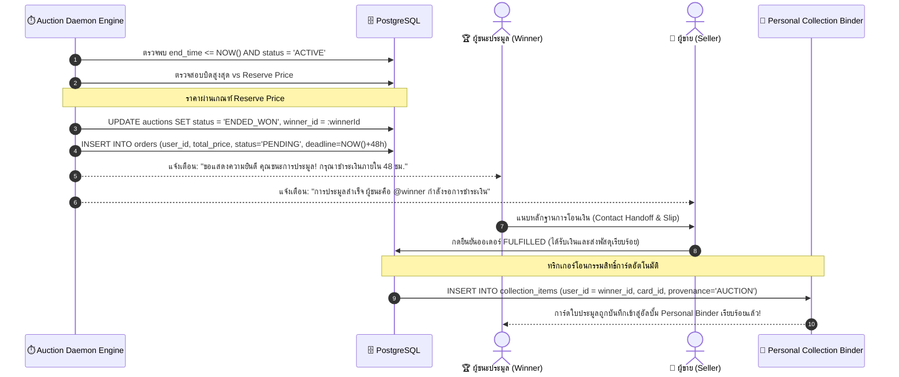
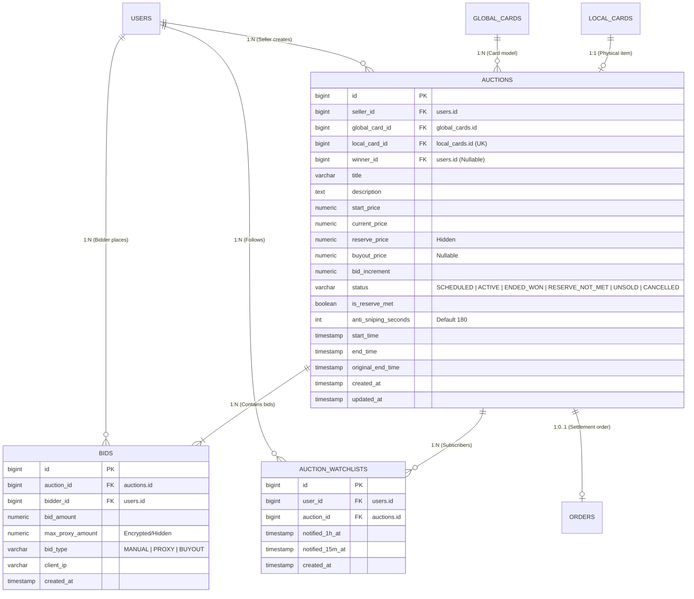

# 🏆 Mythix TCG Platform — Phase 2: Card Auction System Specification & User Stories
> **เอกสารข้อกำหนดความต้องการทางธุรกิจ สถาปัตยกรรมระบบการประมูล และ User Stories ประจำ Phase 2**  
> **Repository:** `User-FlowANDFigma-Progress`  
> **Branch:** `main`  
> **ต่อยอดจาก:** Mythix TCG Platform Phase 1 (Direct C2C Marketplace & Personal Binder)  
> **หัวข้อการพัฒนา:** ระบบประมูลการ์ดสะสมหายาก (Trading Card Real-Time Auction & Settlement Engine)  
> **กลุ่มเป้าหมายระบบ:** นักสะสมการ์ดเกม (Pokémon, One Piece, Magic), ผู้ขายที่ผ่านการยืนยันตัวตน (Verified Sellers), และผู้ดูแลระบบ (Platform Admin)  
> **วันจัดทำ:** ตุลาคม 2026  

---

## 📑 สารบัญ (Table of Contents)
1. [บทนำและภาพรวมของระบบประมูลใน Phase 2 (Executive Overview)](#1-บทนำและภาพรวมของระบบประมูลใน-phase-2-executive-overview)
2. [บทบาทผู้ใช้งานในระบบประมูล (System Personas & Roles)](#2-บทบาทผู้ใช้งานในระบบประมูล-system-personas--roles)
3. [กลไกและกฎเกณฑ์ทางธุรกิจของการประมูล (Core Auction Mechanics & Rules)](#3-กลไกและกฎเกณฑ์ทางธุรกิจของการประมูล-core-auction-mechanics--rules)
4. [สเตตแมชชีนของวงจรชีวิตการประมูล (Auction Lifecycle State Machine)](#4-สเตตแมชชีนของวงจรชีวิตการประมูล-auction-lifecycle-state-machine)
5. [ตารางสรุป User Stories ประจำ Phase 2 ทั้งหมด (Complete User Stories Matrix)](#5-ตารางสรุป-user-stories-ประจำ-phase-2-ทั้งหมด-complete-user-stories-matrix)
6. [รายละเอียดเชิงลึกของ User Stories แยกตามหมวดหมู่ (US-13 ถึง US-19)](#6-รายละเอียดเชิงลึกของ-user-stories-แยกตามหมวดหมู่-us-13-ถึง-us-19)
   - [หมวด US-13: การสร้างและจัดการรายการประมูล (Auction Listing & Setup)](#หมวด-us-13-การสร้างและจัดการรายการประมูล-auction-listing--setup)
   - [หมวด US-14: การสืบค้นและหน้าห้องประมูลสด (Auction Discovery & Live Arena)](#หมวด-us-14-การสืบค้นและหน้าห้องประมูลสด-auction-discovery--live-arena)
   - [หมวด US-15: กลไกการเคาะราคาและระบบประมูลอัตโนมัติ (Bidding Engine & Proxy Bids)](#หมวด-us-15-กลไกการเคาะราคาและระบบประมูลอัตโนมัติ-bidding-engine--proxy-bids)
   - [หมวด US-16: ความโปร่งใสและการป้องกันการทุจริต (Fair-Play & Anti-Fraud Controls)](#หมวด-us-16-ความโปร่งใสและการป้องกันการทุจริต-fair-play--anti-fraud-controls)
   - [หมวด US-17: การปิดประมูล ชำระเงิน และโอนกรรมสิทธิ์ (Resolution, Settlement & Ownership)](#หมวด-us-17-การปิดประมูล-ชำระเงิน-และโอนกรรมสิทธิ์-resolution-settlement--ownership)
   - [หมวด US-18: การเงิน ค่าธรรมเนียม และสถิติการประมูล (Auction Analytics & Finance)](#หมวด-us-18-การเงิน-ค่าธรรมเนียม-และสถิติการประมูล-auction-analytics--finance)
   - [หมวด US-19: การกำกับดูแลและระงับข้อพิพาท (Administration & Dispute Handling)](#หมวด-us-19-การกำกับดูแลและระงับข้อพิพาท-administration--dispute-handling)
7. [แผนภาพลำดับการทำงาน (System Sequence Diagrams)](#7-แผนภาพลำดับการทำงาน-system-sequence-diagrams)
8. [การต่อขยายโครงสร้างฐานข้อมูล (Database Schema Extension)](#8-การต่อขยายโครงสร้างฐานข้อมูล-database-schema-extension)
9. [ข้อกำหนดเชิงเทคนิคและประสิทธิภาพ (Non-Functional Requirements)](#9-ข้อกำหนดเชิงเทคนิคและประสิทธิภาพ-non-functional-requirements)

---

## 1. บทนำและภาพรวมของระบบประมูลใน Phase 2 (Executive Overview)

### 1.1 วิสัยทัศน์ของ Phase 2 (Vision & Strategic Goal)
ใน **Phase 1** ระบบ Mythix TCG Platform ประสบความสำเร็จในการวางรากฐานตลาดซื้อขายการ์ดแบบ **C2C Direct Listing & Atomic Reservation** ควบคู่กับระบบแคตตาล็อกกลาง (Global Catalog), การยืนยันตัวตนผู้ขาย (Seller KYC), และอัลบั้มสะสมการ์ดส่วนบุคคล (Personal Binder)

สำหรับ **Phase 2** แพลตฟอร์มขยายขีดความสามารถเข้าสู่ **"Card Auction Marketplace" (ตลาดประมูลการ์ดสะสมหายาก)** เพื่อตอบโจทย์ธรรมชาติของวงการ Trading Card Game ซึ่งการ์ดระดับ High-End (เช่น การ์ดเกรด PSA/BGS, การ์ดระดับ Secret Rare, หรือการ์ดรางวัลพิเศษ) มีมูลค่าสูงและผันผวนตามความต้องการของนักสะสม การกำหนดราคาขายตายตัวแบบเดิม (Fixed-Price) ไม่สะท้อนมูลค่าตลาดที่แท้จริง ระบบประมูลจึงทำหน้าที่เป็น **Price Discovery Engine** ที่ยุติธรรม โปร่งใส และสร้างความตื่นเต้นให้แก่คอมมูนิตี้

### 1.2 ปัญหาเดิมของตลาดการ์ด และแนวทางแก้ไขในระบบประมูล
* **ปัญหาการใช้ Sniper Bot ดักเคาะวินาทีสุดท้าย (Last-second Sniping):** ผู้ซื้อทั่วไปมักถูกบอทตัดหน้าในเสี้ยววินาทีสุดท้าย  
  👉 **ทางแก้:** **Dynamic Anti-Sniping Engine (Soft-Close):** หากมีการเคาะราคาในช่วง 2-3 นาทีสุดท้ายก่อนปิด ระบบจะต่อเวลาประมูลอัตโนมัติออกไปอีก 3 นาที เพื่อให้ผู้ประมูลตัวจริงสามารถสู้ราคาได้อย่างเป็นธรรม
* **ปัญหาการเคาะปั่นราคาเองโดยผู้ขายหรือหน้าม้า (Shill Bidding):**  
  👉 **ทางแก้:** ตรวจจับและระงับความสัมพันธ์ระหว่างเจ้าของประมูลกับผู้เคาะ (Same User ID, Linked Bank/KYC, IP Tracking) ไม่อนุญาตให้ผู้ขายเคาะการ์ดของตนเอง
* **ปัญหาผู้ชนะการประมูลแล้วเบี้ยวหนี / ไม่ยอมจ่ายเงิน (Defaulting Winner):**  
  👉 **ทางแก้:** **Deposit & Bidder Credit System** (ล็อกเงินมัดจำ/เหรียญเครดิตก่อนเคาะ), กำหนดเวลาชำระเงินเด็ดขาด 48 ชม. หากพ้นกำหนดจะถูกริบมัดจำ ลดคะแนนความน่าเชื่อถือ และมีระบบ **Second-Chance Offer** เสนอขายให้ผู้เคาะอันดับสองทันที
* **ความโปร่งใสในสภาพการ์ดสะสม (True Card Provenance):**  
  👉 **ทางแก้:** ต่อยอดสถาปัตยกรรม Dual-Card จาก Phase 1 โดยการเปิดประมูลต้องผูกกับการ์ดจริง (Local Card) พร้อมภาพถ่ายความละเอียดสูงทุกมุม, ระบุเลขทะเบียนใบรับรองเกรด (PSA/BGS Cert No.), และโอนกรรมสิทธิ์เข้าสู่ **Personal Collection Binder** ของผู้ชนะโดยอัตโนมัติเมื่อปิดออเดอร์

---

## 2. บทบาทผู้ใช้งานในระบบประมูล (System Personas & Roles)

| บทบาท (Role) | สิทธิ์ในระบบ | สิทธิและหน้าที่ในระบบการประมูล (Auction Responsibilities) |
| :--- | :--- | :--- |
| **1. Guest (ผู้เยี่ยมชม)** | `Unauthenticated` | - ชมหน้าศูนย์รวมการประมูล (Auction Hub), ค้นหาและกรองการ์ดที่กำลังเปิดประมูล - ดูเวลานับถอยหลัง (Countdown) และราคาปัจจุบันแบบเรียลไทม์ - ดูกระดานประวัติการเคาะราคา (Public Bid History) - เมื่อกดร่วมประมูล ระบบจะเรียก Contextual Login Modal ขึ้นมาทันที |
| **2. Verified Bidder (ผู้ร่วมประมูล/ผู้ซื้อ)** | `role = 'USER'`, บัญชีผ่านเกณฑ์ | - เคาะประมูลแบบระบุราคาเอง (Manual Direct Bid) - ตั้งค่าเพดานประมูลอัตโนมัติ (Automated Proxy Bidding / Max Bid) - ซื้อทันทีในราคาขาด (Instant Buy-It-Now) - บันทึกการ์ดลงรายการเฝ้าดู (Auction Watchlist) พร้อมรับแจ้งเตือนเมื่อโดนเคาะแซง (Outbid Alert) - ชำระเงินเมื่อชนะการประมูลภายใน 48 ชั่วโมง - รับมอบการ์ดเข้าอัลบั้มสะสมดิจิทัล (Personal Binder) โดยอัตโนมัติ |
| **3. Verified Seller (ผู้เปิดประมูล/ผู้ขาย)** | `role = 'USER'`, `seller_status = 'APPROVED'` | - สร้างและเปิดห้องประมูลการ์ด กำหนดราคาเริ่มต้น (Start Price), ขั้นต่ำการเคาะ (Bid Increment) - กำหนดราคาสำรองขั้นต่ำที่ซ่อนไว้ (Reserve Price) และราคาซื้อทันที (Buyout Price) - กำหนดเวลาเปิดล่วงหน้า (Scheduled) หรือเปิดทันที และเลือกระยะเวลา (1, 3, 5, 7 วัน) - ตรวจสอบรายงานการประมูล ดูสถิติกำไรและราคาจบประมูล - ยื่นสิทธิ์ Second-Chance Offer ให้ผู้เคาะอันดับสองหากผู้ชนะอันดับหนึ่งสละสิทธิ์ |
| **4. Platform Admin (ผู้ดูแลระบบ)** | `role = 'ADMIN'` | - มอนิเตอร์ห้องประมูลทั้งหมดแบบสด (Real-time Auction Monitor) - ระงับหรือยกเลิกการประมูลที่มีข้อพิรุธ (Emergency Pause / Cancel Auction) - ไกล่เกลี่ยข้อพิพาท (Dispute Resolution) และพิจารณาแบน/ตัดสิทธิ์ผู้ใช้งานที่เบี้ยวประมูล - กำหนดค่าพารามิเตอร์ของแพลตฟอร์ม (อัตราค่าธรรมเนียม Commission Fee, เวลา Anti-Sniping) |
| **5. Auction Daemon Engine (ระบบเบื้องหลัง)** | Scheduled Daemon / Event Broker | - ประมวลผลบิดอัตโนมัติแบบ Concurrency Lock (Proxy Bid Evaluator) - ตรวจจับหมดเวลาประมูลอัตโนมัติและตัดสินผู้ชนะ (Closing & Winner Determination) - จัดการระบบ Dynamic Extension เมื่อเกิด Sniping ในนาทีสุดท้าย - ส่ง Push / In-App Notification แจ้งเตือนสถานะการประมูลแบบทันทีทันใด |

---

## 3. กลไกและกฎเกณฑ์ทางธุรกิจของการประมูล (Core Auction Mechanics & Rules)

### 3.1 บันไดขั้นต่ำการเคาะราคา (Minimum Bid Increment Tier)
เพื่อป้องกันการเคาะราคาเพิ่มขึ้นเพียง 1 บาท ระบบจะคำนวณขั้นต่ำของการเคาะครั้งต่อไปตามช่วงราคาปัจจุบัน (Dynamic Increment Ladder):

| ช่วงราคาปัจจุบันของการ์ด (Current High Bid) | ขั้นต่ำในการเคาะราคาเพิ่ม (Minimum Bid Increment) |
| :--- | :--- |
| **1 – 499 บาท** | +20 บาท |
| **500 – 1,999 บาท** | +50 บาท |
| **2,000 – 4,999 บาท** | +100 บาท |
| **5,000 – 19,999 บาท** | +250 บาท |
| **20,000 – 49,999 บาท** | +500 บาท |
| **50,000 บาทขึ้นไป** | +1,000 บาท |

### 3.2 กฎราคาสำรองขั้นต่ำ (Hidden Reserve Price)
* ผู้ขายสามารถตั้งราคา "Reserve Price" ซึ่งเป็นราคาขั้นต่ำที่ผู้ขายยินยอมจะขายจริง โดยผู้ซื้อจะไม่เห็นตัวเลขนี้ (จะเห็นเพียงป้ายกำกับว่า *"Reserve Not Met"* หรือ *"Reserve Met"* เพื่อกระตุ้นการเคาะ)
* หากเมื่อหมดเวลาประมูล ราคาเคาะสูงสุด **ต่ำกว่า Reserve Price** ระบบจะถือว่าการประมูลจบลงด้วยสถานะ `RESERVE_NOT_MET` ผู้ขายไม่มีภาระผูกพันต้องส่งมอบสินค้า และการ์ดจะถูกปลดล็อกกลับคืนสู่สต๊อกของผู้ขาย

### 3.3 ระบบซื้อขาดทันที (Buy-It-Now / Buyout Price)
* ผู้ขายสามารถกำหนดราคา Buy-It-Now ได้ หากมีผู้ซื้อยินยอมจ่ายราคานี้ ห้องประมูลจะปิดตัวลงทันที (`BUYOUT_COMPLETED`) ผู้ซื้อจะชนะการประมูลทันทีโดยไม่ต้องรอจนครบกำหนดเวลา
* **เงื่อนไขปิดออปชัน:** หากมีผู้เคาะราคาประมูลปกติจนทะลุ Reserve Price หรือเกิน 80% ของราคา Buyout แล้ว ออปชัน Buy-It-Now จะถูกปิดลงอัตโนมัติเพื่อให้การประมูลแข่งขันกันต่อไปอย่างเป็นธรรม

### 3.4 กลไกการต่อเวลาแบบยืดหยุ่น (Dynamic Anti-Sniping / Soft-Close)
* หากมีการเคาะราคาใหม่เกิดขึ้นภายใน **3 นาทีสุดท้าย (180 วินาที)** ก่อนหมดเวลา ระบบจะขยายเวลาปิดประมูลออกไปอีก **3 นาที** โดยอัตโนมัติ
* การต่อเวลาสามารถเกิดขึ้นต่อเนื่องได้สูงสุดไม่เกิน 15 นาทีจากกำหนดการเดิม (Cap Limit) เพื่อป้องกันไม่ให้การประมูลยืดเยื้อข้ามวัน

### 3.5 ระบบบิดอัตโนมัติ (Automated Proxy Bidding)
* ผู้ซื้อสามารถตั้งราคา "เพดานสูงสุดที่ตนยินดีจ่าย" (Maximum Bid) ไว้ในระบบ
* Proxy Engine จะทำหน้าที่เคาะราคาแทนผู้ซื้อทีละขั้นต่ำ (Increment) เพื่อรักษาตำแหน่งผู้ชนะไว้เสมอ โดยจะไม่เคาะกระโดดไปที่ราคาสูงสุดทันที แต่จะเคาะสูงกว่าผู้แข่งขันคนอื่นเพียง 1 ขั้นต่ำเท่านั้น ช่วยให้ผู้ซื้อไม่ต้องเฝ้าหน้าจอตลอดเวลา

---

## 4. สเตตแมชชีนของวงจรชีวิตการประมูล (Auction Lifecycle State Machine)

---

## 5. ตารางสรุป User Stories ประจำ Phase 2 ทั้งหมด (Complete User Stories Matrix)

ใน Phase 2 ระบบได้รับการออกแบบตามมาตรฐาน Agile ครอบคลุม **32 User Stories ย่อย** จัดกลุ่มใน 7 หมวดหมู่หลัก (**US-13 ถึง US-19**) ดังนี้:

| รหัส US | ชื่อฟีเจอร์ (Feature Title) | ผู้ใช้หลัก (Actor) | ขอบเขตโมดูล | ระดับความสำคัญ (MoSCoW) |
| :--- | :--- | :--- | :--- | :--- |
| **US-13-1** | Create Card Auction Listing from Catalog/Collection | Verified Seller | Frontend / Backend / Auction | **Must Have** |
| **US-13-2** | Configure Hidden Reserve Price & Buy-It-Now | Verified Seller | Frontend / Backend / Auction | **Must Have** |
| **US-13-3** | Schedule Auction Start Time & Duration | Verified Seller | Frontend / Backend / Scheduler | **Must Have** |
| **US-13-4** | Seller Auction Dashboard & Draft Management | Verified Seller | Frontend / Backend / Seller | **Should Have** |
| **US-13-5** | Seller Auction Early Cancellation Rules | Verified Seller | Frontend / Backend / Business Rule | **Must Have** |
| **US-14-1** | Browse Auctions Hub with Multi-Filter & Ending Soon | Guest / Bidder | Frontend / Backend / Discovery | **Must Have** |
| **US-14-2** | Live Auction Room with Real-Time WebSocket Ticker | Guest / Bidder | Frontend / Backend / WebSocket | **Must Have** |
| **US-14-3** | Transparent Public Bid History (Masked Identities) | Guest / Bidder | Frontend / Backend / Privacy | **Must Have** |
| **US-14-4** | Auction Watchlist & Ending Countdown Alert | Verified Bidder | Frontend / Backend / Notification | **Should Have** |
| **US-14-5** | High-Value & Graded Card Verification Badge Display | Guest / Bidder | Frontend / UI Components | **Should Have** |
| **US-15-1** | Manual Direct Bidding with Real-Time Validation | Verified Bidder | Frontend / Backend / Bidding | **Must Have** |
| **US-15-2** | Automated Proxy Bidding Engine (Max Bid) | Verified Bidder | Backend / Proxy Engine | **Must Have** |
| **US-15-3** | Instant Buy-It-Now Purchase Flow | Verified Bidder | Frontend / Backend / Checkout | **Must Have** |
| **US-15-4** | Instant Outbid In-App & Push Notification | Verified Bidder | Frontend / Backend / Notification | **Must Have** |
| **US-15-5** | Bid Confirmation Modal & Increment Ladder Helper | Verified Bidder | Frontend / UI Components | **Should Have** |
| **US-16-1** | Anti-Shill Bidding & Self-Bid Restrictions | System Engine | Backend / Security Gate | **Must Have** |
| **US-16-2** | Dynamic Anti-Sniping Engine (3-Minute Soft Close) | System Engine | Backend / Auction Scheduler | **Must Have** |
| **US-16-3** | Bidder Eligibility & Deposit Credit Hold | System Engine | Backend / Wallet & Fraud | **Should Have** |
| **US-16-4** | Strict Bid Retraction Policy Enforcement | Bidder / Admin | Backend / Governance | **Must Have** |
| **US-17-1** | Automated Closing & Winner Determination Service | System Engine | Backend / Cron Daemon | **Must Have** |
| **US-17-2** | Settlement for Reserve-Not-Met & Unsold Auctions | System Engine | Backend / Stock Management | **Must Have** |
| **US-17-3** | Winner Checkout & 48-Hour Payment Gateway Window | Winner (Bidder) | Frontend / Backend / Order | **Must Have** |
| **US-17-4** | Automated Card Ownership Transfer into Personal Binder | System Engine | Backend / Database Trigger | **Must Have** |
| **US-17-5** | Second-Chance Offer for Runner-up Bidders | Seller / Bidder | Frontend / Backend / Auction | **Could Have** |
| **US-17-6** | Defaulting Bidder Penalty & Reputation Strike | System Engine | Backend / User Reputation | **Should Have** |
| **US-18-1** | Seller Auction Revenue, Cost & Net Margin Analytics | Verified Seller | Frontend / Backend / Analytics | **Should Have** |
| **US-18-2** | Platform Auction Fee & Commission Auto-Deduction | Platform / Seller | Backend / Accounting | **Must Have** |
| **US-18-3** | Buyer Personal Auction Portfolio & Win-Rate Stats | Verified Bidder | Frontend / Backend / Collector | **Could Have** |
| **US-19-1** | Platform Admin Live Auction Monitoring Console | Platform Admin | Frontend / Backend / Admin | **Must Have** |
| **US-19-2** | Emergency Auction Pause & Force-Cancellation | Platform Admin | Frontend / Backend / Admin | **Must Have** |
| **US-19-3** | Auction Dispute Resolution Center (Counterfeit/Damage) | Admin / Seller / Bidder | Frontend / Backend / Support | **Should Have** |
| **US-19-4** | Immutable Security Audit Trail for Auction Actions | Platform Admin | Backend / Audit Database | **Must Have** |

---

## 6. รายละเอียดเชิงลึกของ User Stories แยกตามหมวดหมู่ (US-13 ถึง US-19)

### หมวด US-13: การสร้างและจัดการรายการประมูล (Auction Listing & Setup)

#### 🔹 US-13-1: Create Card Auction Listing from Catalog/Collection
* **คำอธิบาย (Story):** ในฐานะผู้ขายที่ได้รับการรับรอง (Verified Seller) ฉันต้องการสร้างรายการประมูลการ์ดใบใหม่ โดยดึงข้อมูลพื้นฐานจากการ์ดต้นแบบในแคตตาล็อก และระบุสภาพการ์ดจริง พร้อมภาพถ่ายจริง เพื่อเปิดประมูลการ์ดในระบบ
* **Acceptance Criteria:**
  - [x] ผู้ขายต้องมีสถานะ `seller_status = 'APPROVED'` เท่านั้นจึงจะเข้าถึงฟอร์มสร้างการประมูลได้
  - [x] ผู้ขายสามารถค้นหาและเลือก `global_card_id` เพื่อดึงชื่อการ์ด เซ็ต และรูปต้นแบบมาเป็นฐานข้อมูล
  - [x] ผู้ขายต้องระบุสภาพการ์ดจริง (NM, LP, MP, HP, DMG) และสามารถระบุรายละเอียดการเกรดการ์ด (เช่น PSA 10, BGS 9.5 พร้อมเลข Cert No.)
  - [x] บังคับให้อัปโหลดภาพถ่ายการ์ดจริงอย่างน้อย 2 ภาพ (ด้านหน้าและด้านหลังความละเอียดสูง)
  - [x] ต้องกำหนดราคาเริ่มต้น (`start_price`) มากกว่า 0 บาท
  - [x] สินค้าที่ถูกนำมาตั้งประมูลจะถูกล็อกสต๊อกทันที (`auction_locked = true`) เพื่อป้องกันไม่ให้ถูกนำไปขายทับซ้อนในหน้าร้าน Direct Sale
* **API Endpoints:** `POST /api/seller/auctions`

#### 🔹 US-13-2: Configure Hidden Reserve Price & Buy-It-Now
* **คำอธิบาย (Story):** ในฐานะผู้ขาย ฉันต้องการตั้งราคาขั้นต่ำที่ฉันยอมรับได้ (Reserve Price) และตัวเลือกราคาซื้อทันที (Buy-It-Now) เพื่อลดความเสี่ยงจากการขาดทุนและเปิดโอกาสให้ผู้ซื้อที่รีบใช้งานสามารถจบการประมูลได้ทันที
* **Acceptance Criteria:**
  - [x] ผู้ขายสามารถเปิดใช้งานตัวเลือก "Reserve Price" ได้ โดยค่า Reserve Price ต้องมากกว่าหรือเท่ากับ Start Price
  - [x] ระบบต้องไม่เปิดเผยตัวเลข Reserve Price สู่หน้าบ้านของฝั่งผู้ซื้อ (ส่งไปเฉพาะ flag `is_reserve_met = boolean`)
  - [x] ผู้ขายสามารถเปิดใช้งานตัวเลือก "Buy-It-Now Price" โดยราคาซื้อทันทีต้องมากกว่าทั้ง Start Price และ Reserve Price
  - [x] ข้อมูลราคาทั้งหมดถูกตรวจสอบความถูกต้อง (Validation) ฝั่งเซิร์ฟเวอร์
* **API Endpoints:** รวมอยู่ใน Payload ของ `POST /api/seller/auctions`

#### 🔹 US-13-3: Schedule Auction Start Time & Duration
* **คำอธิบาย (Story):** ในฐานะผู้ขาย ฉันต้องการตั้งเวลาเริ่มการประมูลล่วงหน้า (Scheduled) หรือเริ่มทันที และเลือกระยะเวลาสิ้นสุด (1 วัน, 3 วัน, 5 วัน, 7 วัน) เพื่อให้ตรงกับช่วงเวลาที่กลุ่มเป้าหมายออนไลน์มากที่สุด
* **Acceptance Criteria:**
  - [x] สามารถเลือกเริ่มทันที (`start_now = true`) สถานะจะกลายเป็น `ACTIVE` ทันที
  - [x] สามารถเลือกเริ่มในอนาคต โดยเวลาเริ่มต้องมากกว่าเวลาปัจจุบันอย่างน้อย 15 นาที สถานะจะเป็น `SCHEDULED`
  - [x] ตัวเลือกระยะเวลาการประมูล (Duration): 24 ชั่วโมง, 3 วัน, 5 วัน, และ 7 วัน
  - [x] ระบบคำนวณและบันทึก `end_time` ลงฐานข้อมูลด้วยความแม่นยำระดับวินาที (UTC Timestamp)
* **API Endpoints:** `POST /api/seller/auctions/schedule`

#### 🔹 US-13-4: Seller Auction Dashboard & Draft Management
* **คำอธิบาย (Story):** ในฐานะผู้ขาย ฉันต้องการหน้าแดชบอร์ดจัดการการประมูลของฉัน เพื่อดูสถานะการประมูลทั้งหมด (ร่าง, รอเปิด, กำลังเปิด, จบแล้ว) และจัดการแก้ไขข้อมูลฉบับร่าง
* **Acceptance Criteria:**
  - [x] แสดงแท็บแยกสถานะชัดเจน: Drafts, Scheduled, Active, Ended & Awaiting Payment, Completed
  - [x] แสดงตัวเลขยอดเคาะสูงสุดปัจจุบัน, จำนวนครั้งที่เคาะ (Total Bids), และเวลานับถอยหลังของแต่ละห้อง
  - [x] รายการสถานะ Draft สามารถแก้ไขหรือลบทิ้งได้ตลอดเวลา
* **API Endpoints:** `GET /api/seller/auctions`

#### 🔹 US-13-5: Seller Auction Early Cancellation Rules
* **คำอธิบาย (Story):** ในฐานะระบบและผู้ขาย ฉันต้องการกฎเกณฑ์ที่ชัดเจนเกี่ยวกับการยกเลิกการประมูล เพื่อคุ้มครองความเชื่อมั่นของผู้ประมูล
* **Acceptance Criteria:**
  - [x] หากห้องประมูลยัง **ไม่มีผู้ใดเคาะราคา (0 bids)** ผู้ขายสามารถกดยกเลิกการประมูล (`CANCELLED`) ได้ด้วยตนเอง
  - [x] หากห้องประมูล **มีผู้เคาะราคาแล้วอย่างน้อย 1 ครั้ง** ผู้ขายจะ **ไม่สามารถกดยกเลิกได้เอง** ผ่านหน้าบ้าน
  - [x] หากมีเหตุสุดวิสัย (เช่น การ์ดชำรุดเสียหาย) ผู้ขายต้องส่งคำขอยกเลิกไปยัง Admin พร้อมแนบหลักฐาน
* **API Endpoints:** `DELETE /api/seller/auctions/{auctionId}`

---

### หมวด US-14: การสืบค้นและหน้าห้องประมูลสด (Auction Discovery & Live Arena)

#### 🔹 US-14-1: Browse Auctions Hub with Multi-Filter & Ending Soon
* **คำอธิบาย (Story):** ในฐานะผู้ใช้งานทั่วไปและผู้ซื้อ ฉันต้องการหน้าศูนย์กลางการประมูล (Auction Hub) เพื่อค้นหาและคัดกรองการ์ดที่สนใจตามสถานะและเวลาที่ใกล้ปิด
* **Acceptance Criteria:**
  - [x] มีแท็บด่วน: **"Ending Soon"** (เรียงตามเวลาใกล้ปิดมากสุด), **"Hot Bids"** (เรียงตามจำนวนครั้งที่เคาะ), **"No Reserve"**, **"Buy-It-Now Available"**
  - [x] Multi-Filters: กรองตามชื่อการ์ด, เกมการ์ด, ชุดการ์ด (Set), สภาพการ์ด, และช่วงราคาปัจจุบัน
  - [x] การ์ดแต่ละใบแสดง Countdown Timer นับถอยหลังแบบ Real-time, ราคาเคาะปัจจุบัน, และจำนวนครั้งที่เคาะ
* **API Endpoints:** `GET /api/auctions?status=ACTIVE&sort=ending_soon`

#### 🔹 US-14-2: Live Auction Room with Real-Time WebSocket Ticker
* **คำอธิบาย (Story):** ในฐานะผู้ซื้อ ฉันต้องการให้หน้ารายละเอียดห้องประมูล (Live Room) แสดงการเปลี่ยนแปลงของราคาและเวลานับถอยหลังแบบเรียลไทม์โดยไม่ต้องกดรีเฟรชหน้าจอ
* **Acceptance Criteria:**
  - [x] เชื่อมต่อผ่าน WebSocket (STOMP Protocol over `/topic/auctions/{id}`)
  - [x] เมื่อมีผู้เคาะราคาใหม่ หน้าจอของผู้ใช้ทุกคนที่เปิดหน้านั้นอยู่จะแสดง Animation อัปเดตราคาใหม่ทันทีภายในเวลาน้อยกว่า 500ms
  - [x] เวลานับถอยหลังซิงโครไนซ์กับ Server Clock ป้องกันปัญหาความคลาดเคลื่อนของเวลาในเครื่อง Client
  - [x] หากระบบเกิดการ Anti-Sniping ต่อเวลา หน้าจอจะแสดง Badge กระพริบแจ้งเตือน *"Time Extended +3 Minutes!"*
* **API / WebSocket Topic:** `WS /topic/auctions/{auctionId}`

#### 🔹 US-14-3: Transparent Public Bid History (Masked Identities)
* **คำอธิบาย (Story):** ในฐานะผู้ประมูล ฉันต้องการดูกระดานประวัติการเคาะราคาย้อนหลังในห้องประมูล เพื่อความโปร่งใสและตรวจสอบได้ว่ามีการแข่งขันจริง
* **Acceptance Criteria:**
  - [x] แสดงตารางประวัติการเคาะ: วัน-เวลา (Timestamp), ราคาที่เคาะ (Bid Amount), และชื่อผู้เคาะ
  - [x] ชื่อผู้เคาะต้องถูกปกปิดตัวตนบางส่วน (Masked Identity) เพื่อความปลอดภัย เช่น `k***n` หรือ `P***1` (ยกเว้นเจ้าตัวจะเห็นชื่อตนเองเป็น *"You"*)
  - [x] ระบุประเภทการเคาะชัดเจน (เช่น Manual Bid, Proxy Auto-Bid, Buy-It-Now)
* **API Endpoints:** `GET /api/auctions/{auctionId}/bids`

#### 🔹 US-14-4: Auction Watchlist & Ending Countdown Alert
* **คำอธิบาย (Story):** ในฐานะนักสะสม ฉันต้องการบันทึกห้องประมูลการ์ดที่สนใจเข้าใน Watchlist ส่วนตัว เพื่อให้ระบบแจ้งเตือนเมื่อใกล้หมดเวลา
* **Acceptance Criteria:**
  - [x] มีปุ่มกระดิ่ง/รูปหัวใจให้กด "Watch / Bookmark" ในการ์ดทุกใบ
  - [x] ระบบส่ง In-App Notification แจ้งเตือนเมื่อเหลือเวลา 1 ชั่วโมง และ 15 นาทีก่อนปิดประมูล
  - [x] มีหน้าเมนู `/my-watchlist` รวบรวมการ์ดประมูลที่บันทึกไว้ทั้งหมด
* **API Endpoints:** `POST /api/auctions/{auctionId}/watch`, `GET /api/user/watchlist`

#### 🔹 US-14-5: High-Value & Graded Card Verification Badge Display
* **คำอธิบาย (Story):** ในฐานะผู้ซื้อ ฉันต้องการเห็นเครื่องหมายรับรองของการ์ดเกรดและร้านค้าที่เชื่อถือได้ เพื่อความมั่นใจก่อนลงเงินประมูลมูลค่าสูง
* **Acceptance Criteria:**
  - [x] แสดง Badge รับรองสถาบันเกรด (เช่น PSA, BGS, CGC) พร้อมเกรดคะแนน เช่น `PSA 10 GEM MT` อย่างเด่นชัด
  - [x] มีปุ่มคลิกตรวจสอบรหัสรับรอง (Certification Verification Link) ลิงก์ไปยังฐานข้อมูล Official ของสถาบันเกรดนั้นๆ
  - [x] แสดงประวัติความน่าเชื่อถือของผู้ขาย (Seller Rating & Completed Auctions Count)
* **UI Components:** `GradedCardBadge`, `SellerReputationPill`

---

### หมวด US-15: กลไกการเคาะราคาและระบบประมูลอัตโนมัติ (Bidding Engine & Proxy Bids)

#### 🔹 US-15-1: Manual Direct Bidding with Real-Time Validation
* **คำอธิบาย (Story):** ในฐานะผู้ซื้อ ฉันต้องการเคาะสู้ราคาด้วยตนเองตามขั้นต่ำที่ระบบแนะนำ หรือระบุราคาที่ฉันต้องการ เพื่อก้าวขึ้นเป็นผู้ให้ราคาสูงสุด
* **Acceptance Criteria:**
  - [x] ระบบแสดงราคาเคาะขั้นต่ำถัดไป (`Next Minimum Bid = Current Bid + Increment`)
  - [x] หากผู้ซื้อกรอกราคาเอง ราคาต้องมากกว่าหรือเท่ากับ Next Minimum Bid เสมอ
  - [x] การส่งคำขอเคาะราคาใช้ Database Row Locking ป้องกัน Race Condition เมื่อมีคนเคาะพร้อมกันในเสี้ยววินาที
  - [x] หากเคาะสำเร็จ ระบบตอบกลับด้วยสถานะสำเร็จ และกระจายข้อมูลไปยัง WebSocket
  - [x] หากมีผู้อื่นเคาะราคาสูงกว่าตัดหน้าไปก่อนในเสี้ยววินาที ระบบส่งแจ้งเตือน Error ทันทีว่า *"Your bid was placed too late. Current price has changed."*
* **API Endpoints:** `POST /api/auctions/{auctionId}/bids`

#### 🔹 US-15-2: Automated Proxy Bidding Engine (Max Bid)
* **คำอธิบาย (Story):** ในฐานะผู้ซื้อที่ไม่สะดวกเฝ้าหน้าจอ ฉันต้องการตั้งเพดานราคาสูงสุดที่ฉันยอมจ่าย (Max Proxy Bid) เพื่อให้ระบบเคาะสู้ราคาแทนฉันโดยอัตโนมัติด้วยราคาที่ต่ำที่สุดที่จำเป็น
* **Acceptance Criteria:**
  - [x] ผู้ซื้อสามารถกรอก "Maximum Bid" ที่ตนยินดีจ่าย
  - [x] ระบบ Proxy Engine จะคำนวณและเคาะราคาในระบบให้สูงกว่าผู้แข่งขันคนอื่นเพียง 1 ขั้นต่ำเสมอ จนกว่าราคาจะเกิน Max Bid ของผู้ซื้อ
  - [x] ตัวเลข Max Bid ของผู้ซื้อจะถูกเก็บเป็นความลับสูงสุด ห้ามส่งออกไปใน API สาธารณะเด็ดขาด
  - [x] หากมีผู้ซื้อสองคนตั้ง Proxy Bid ชนกัน ระบบจะให้สิทธิ์แก่ผู้ที่ตั้ง Proxy Bid มาก่อนตามเวลาจริง (First-Come First-Served)
* **API Endpoints:** `POST /api/auctions/{auctionId}/proxy-bid`

#### 🔹 US-15-3: Instant Buy-It-Now Purchase Flow
* **คำอธิบาย (Story):** ในฐานะผู้ซื้อที่ต้องการการ์ดใบนี้ทันทีและไม่อยากเสี่ยงประมูลแข่ง ฉันต้องการกดซื้อขาดในราคา Buy-It-Now เพื่อปิดการประมูลและรับการ์ดทันที
* **Acceptance Criteria:**
  - [x] ปุ่ม "Buy Now for ฿XX,XXX" จะแสดงเฉพาะในห้องที่มีการเปิดออปชันนี้ และเงื่อนไขยังไม่ถูกยกเลิก
  - [x] เมื่อกดปุ่ม มี Modal สรุปราคาและขอยืนยันคำสั่งซื้อ
  - [x] เมื่อยืนยันสำเร็จ ระบบจะเปลี่ยนสถานะการประมูลเป็น `BUYOUT_COMPLETED` ทันที และยกเลิกการเคาะราคาทั้งหมด
  - [x] สร้าง Order สั่งซื้อสำหรับผู้ซื้อคนดังกล่าวโดยอัตโนมัติ
* **API Endpoints:** `POST /api/auctions/{auctionId}/buyout`

#### 🔹 US-15-4: Instant Outbid In-App & Push Notification
* **คำอธิบาย (Story):** ในฐานะผู้ที่กำลังนำการประมูล ฉันต้องการรับการแจ้งเตือนทันทีเมื่อมีผู้ประมูลคนอื่นเคาะราคาแซงฉัน เพื่อให้ฉันสามารถตัดสินใจเข้ามาเคาะสู้ได้ทันท่วงที
* **Acceptance Criteria:**
  - [x] ระบบส่ง Notification Event ทันทีที่สถานะ High Bidder เปลี่ยนมือ
  - [x] ผู้ใช้ที่ถูกแซงจะได้รับ In-App Alert (Banner ลอย) และเสียงแจ้งเตือนหากเปิดหน้าเว็บอยู่
  - [x] มีปุ่มลัด "Bid Again" ในการแจ้งเตือน เพื่อกดกลับเข้าสู่ห้องประมูลนั้นทันที
* **API Endpoints:** `GET /api/user/notifications` / SSE Channel

#### 🔹 US-15-5: Bid Confirmation Modal & Increment Ladder Helper
* **คำอธิบาย (Story):** ในฐานะผู้ประมูล ฉันต้องการ Modal ตรวจสอบความถูกต้องและปุ่มเพิ่มราคาทีละขั้นแบบ Quick Step (+1 Step, +2 Steps, +5 Steps) เพื่อป้องกันการกดตัวเลขผิดพลาด
* **Acceptance Criteria:**
  - [x] มีปุ่มด่วนสำหรับเคาะตามสเต็ป เช่น `+฿50`, `+฿100`, `+฿500`
  - [x] Modal แสดงราคายืนยันตัวเลขชัดเจน พร้อมข้อความเตือนว่า *"การเคาะราคาถือเป็นข้อผูกพันทางกฎหมายของแพลตฟอร์ม"*
* **UI Components:** `BidConfirmDialog`, `QuickBidStepper`

---

### หมวด US-16: ความโปร่งใสและการป้องกันการทุจริต (Fair-Play & Anti-Fraud Controls)

#### 🔹 US-16-1: Anti-Shill Bidding & Self-Bid Restrictions
* **คำอธิบาย (Story):** ในฐานะระบบความปลอดภัย ฉันต้องการบล็อกความพยายามในการปั่นราคาของผู้ขาย เพื่อรับรองความยุติธรรมของผู้ร่วมประมูลทุกคน
* **Acceptance Criteria:**
  - [x] ปฏิเสธการเคาะราคาหาก `bidder_id == seller_id` ของห้องประมูลนั้น (HTTP 403 Forbidden)
  - [x] ตรวจสอบความเชื่อมโยงของข้อมูล: บล็อกหากผู้เคาะใช้หมายเลขบัตรประชาชน, บัญชีธนาคาร, หรือเบอร์โทรศัพท์เดียวกับผู้ขาย
  - [x] บันทึกพฤติกรรมน่าสงสัยลงใน `audit_logs` พร้อมแจ้งเตือนทีม Admin มอนิเตอร์
* **Security Layer:** `AuctionSecurityValidator.java`

#### 🔹 US-16-2: Dynamic Anti-Sniping Engine (3-Minute Soft Close)
* **คำอธิบาย (Story):** ในฐานะผู้ประมูล ฉันต้องการให้ระบบยืดเวลาประมูลอัตโนมัติหากมีการเคาะในนาทีสุดท้าย เพื่อป้องกันการใช้โปรแกรม Sniper Bot แย่งเคาะในวินาที 0.01
* **Acceptance Criteria:**
  - [x] ทุกครั้งที่มีการเคาะราคาสำเร็จ ระบบตรวจสอบว่า `(end_time - current_time) <= 180 วินาที` หรือไม่
  - [x] หากเงื่อนไขเป็นจริง ให้ขยาย `end_time = current_time + 180 วินาที` ทันที
  - [x] อัปเดตเวลานับถอยหลังใหม่ผ่าน WebSocket ทันที
  - [x] อนุญาตให้ขยายเวลารวมกันสูงสุดไม่เกิน 15 นาทีจากเวลาปิดประมูลรอบแรกเดิม (Max Cap)
* **Backend Logic:** `AuctionTimeManager.handleBidExtension()`

#### 🔹 US-16-3: Bidder Eligibility & Deposit Credit Hold
* **คำอธิบาย (Story):** ในฐานะผู้ขายและแพลตฟอร์ม ฉันต้องการคัดกรองผู้เข้าร่วมประมูล เพื่อป้องกันบัญชีผีหรือผู้ใช้ที่ไม่มีเจตนาชำระเงินจริง
* **Acceptance Criteria:**
  - [x] ผู้ที่จะเข้าร่วมประมูลต้องผ่านการยืนยันเบอร์โทรศัพท์ (SMS Verified) หรือมีประวัติสั่งซื้อสมบูรณ์ใน Phase 1 อย่างน้อย 1 ครั้ง
  - [x] สำหรับการประมูล High-Value (ราคามากกว่า 10,000 บาท) ระบบสามารถเปิดโหมด Hold มัดจำเครดิต (เช่น 5-10% ของราคาเริ่มต้น) ซึ่งจะถูกปลดล็อกคืนเมื่อมีผู้อื่นเคาะแซง หรือเมื่อจบการประมูล
* **Security Layer:** `BidderEligibilityGate.java`

#### 🔹 US-16-4: Strict Bid Retraction Policy Enforcement
* **คำอธิบาย (Story):** ในฐานะแพลตฟอร์ม ฉันต้องการกำหนดนโยบายห้ามยกเลิกการเคาะราคาตามอำเภอใจ เพื่อรักษาเสถียรภาพของการประมูล
* **Acceptance Criteria:**
  - [x] ผู้ประมูลไม่สามารถกดยกเลิกการเคาะราคาของตนเองได้ด้วยตนเอง
  - [x] การขอยกเลิกทำได้เฉพาะกรณี "พิมพ์ตัวเลขผิดพลาดร้ายแรงและชัดเจน" (Typo Error เช่น ตั้งใจเคาะ 500 แต่พิมพ์ 50,000) โดยต้องยื่นคำร้องต่อ Admin ภายในเวลา 5 นาทีหลังการเคาะ
  - [x] Admin เป็นผู้มีสิทธิ์อนุมัติการยกเลิกบิด และระบบจะทำการย้อนสถานะราคาปัจจุบันกลับไปยังบิดก่อนหน้า (Rollback Bid State)
* **API Endpoints:** `POST /api/auctions/{auctionId}/bid-retraction-requests`

---

### หมวด US-17: การปิดประมูล ชำระเงิน และโอนกรรมสิทธิ์ (Resolution, Settlement & Ownership)

#### 🔹 US-17-1: Automated Closing & Winner Determination Service
* **คำอธิบาย (Story):** ในฐานะระบบอัตโนมัติ ฉันต้องการประมวลผลห้องประมูลที่หมดเวลาแบบเรียลไทม์ เพื่อสรุปผลผู้ชนะอย่างแม่นยำและเที่ยงธรรม
* **Acceptance Criteria:**
  - [x] ทำงานผ่าน Scheduled Daemon Engine (รันตรวจสอบทุกวินาทีหรือทุก 5 วินาที)
  - [x] เมื่อ `current_time >= end_time` ห้องประมูลเปลี่ยนสถานะจาก `ACTIVE` ทันที
  - [x] หากมีผู้เคาะราคา และราคาสูงสุด >= `reserve_price` → ปรับสถานะเป็น `ENDED_WON` และประกาศผู้ชนะ
  - [x] ส่ง Notification ถึงทั้งผู้ซื้อ (ผู้ชนะ) และผู้ขายทันที
* **Backend Job:** `AuctionClosingScheduler.java`

#### 🔹 US-17-2: Settlement for Reserve-Not-Met & Unsold Auctions
* **คำอธิบาย (Story):** ในฐานะผู้ขาย ฉันต้องการให้ระบบปลดล็อกการ์ดและปิดการประมูลอย่างถูกต้องเมื่อราคาประมูลไม่ถึงเกณฑ์ที่ฉันยอมรับ
* **Acceptance Criteria:**
  - [x] หากหมดเวลาแล้วไม่มีผู้ใดเคาะราคาเลย → สถานะเป็น `UNSOLD_NO_BIDS`
  - [x] หากมีผู้เคาะราคา แต่ราคาสูงสุดต่ำกว่า `reserve_price` → สถานะเป็น `RESERVE_NOT_MET`
  - [x] สต๊อกการ์ดของผู้ขายจะถูกปลดล็อกสถานะ (`auction_locked = false`) เพื่อให้ผู้ขายนำกลับไปวางขายแบบปกติ หรือเปิดประมูลใหม่ได้ทันที
* **API Endpoints:** `GET /api/seller/auctions/{id}/settlement-status`

#### 🔹 US-17-3: Winner Checkout & 48-Hour Payment Gateway Window
* **คำอธิบาย (Story):** ในฐานะผู้ชนะการประมูล ฉันต้องการหน้าชำระเงินและช่องทางติดต่อเพื่อโอนเงินชำระค่าการ์ดภายในเวลา 48 ชั่วโมง
* **Acceptance Criteria:**
  - [x] ระบบสร้างออเดอร์พิเศษ (`order_type = 'AUCTION'`) ให้ผู้ชนะทันที พร้อมกำหนดเวลาเส้นตาย `payment_deadline = closed_at + 48 hours`
  - [x] แสดงหน้าจอ Checkout พร้อมข้อมูลสรุป: ราคาจบการประมูล, ค่าจัดส่ง, และช่องทางการชำระเงินของผู้ขาย (พร้อมปุ่มแนบสลิป/หลักฐานการโอน)
  - [x] มีเวลานับถอยหลังเส้นตายชำระเงิน และแจ้งเตือนเมื่อเหลือเวลา 12 ชม. สุดท้าย
* **API Endpoints:** `POST /api/orders/auction-checkout`

#### 🔹 US-17-4: Automated Card Ownership Transfer into Personal Binder
* **คำอธิบาย (Story):** ในฐานะผู้ชนะและนักสะสม เมื่อฉันชำระเงินและผู้ขายส่งมอบสินค้าเสร็จสิ้น ฉันต้องการให้การ์ดใบประมูลนั้นถูกโอนเข้าอัลบั้มสะสมดิจิทัล (Personal Collection Binder) ของฉันโดยอัตโนมัติ
* **Acceptance Criteria:**
  - [x] เมื่อผู้ขายกดยืนยันออเดอร์เป็น `FULFILLED` ระบบจะรันกระบวนการโอนกรรมสิทธิ์ทันที
  - [x] เพิ่มรายการการ์ดลงในตาราง `collection_items` ของผู้ซื้อ พร้อมระบุสภาพ สถาบันเกรด และประวัติว่าได้มาจากการประมูล (Provenance: Auction #ID)
  - [x] แสดงตราสัญลักษณ์ "Auction Won Trophy" ในหน้ารายละเอียดการ์ดของอัลบั้มส่วนตัว
* **Integration Module:** เชื่อมต่อกับระบบ Personal Binder จาก Phase 1 (`US-10-1`, `US-07-3`)

#### 🔹 US-17-5: Second-Chance Offer for Runner-up Bidders
* **คำอธิบาย (Story):** ในฐานะผู้ขาย หากผู้ชนะการประมูลอันดับหนึ่งไม่สามารถชำระเงินได้ ฉันต้องการส่งข้อเสนอขายให้แก่ผู้ประมูลอันดับสอง (Runner-up) ในราคาที่เขาเคยเคาะไว้ เพื่อไม่ต้องเปิดประมูลใหม่ตั้งแต่ต้น
* **Acceptance Criteria:**
  - [x] ผู้ขายสามารถกดส่ง "Second Chance Offer" ให้แก่ผู้เคาะอันดับถัดไปได้ภายใน 24 ชม. หลังผู้ชนะคนแรกถูกตัดสิทธิ์
  - [x] ผู้ประมูลอันดับสองจะได้รับการแจ้งเตือนพิเศษ และมีเวลา 24 ชม. ในการกดยอมรับหรือปฏิเสธข้อเสนอนี้
  - [x] หากกดยอมรับ ระบบจะออกออเดอร์ให้ผู้ซื้ออันดับสองทันทีในราคาที่เขาเคยเคาะไว้
* **API Endpoints:** `POST /api/seller/auctions/{auctionId}/second-chance-offer`

#### 🔹 US-17-6: Defaulting Bidder Penalty & Reputation Strike
* **คำอธิบาย (Story):** ในฐานะระบบ ฉันต้องการลงโทษผู้ชนะการประมูลที่ไม่ยอมชำระเงินภายในกำหนด เพื่อปกป้องผลประโยชน์ของผู้ขายและความน่าเชื่อถือของแพลตฟอร์ม
* **Acceptance Criteria:**
  - [x] เมื่อพ้นกำหนด 48 ชั่วโมงโดยไม่มีการชำระเงิน ออเดอร์จะเปลี่ยนสถานะเป็น `DEFAULTED`
  - [x] ผู้ใช้จะได้รับคะแนนตัดสิทธิ์ (Reputation Strike) 1 ครั้ง
  - [x] หากสะสมครบ 2 Strikes บัญชีจะถูกระงับสิทธิ์การเข้าร่วมประมูล (Auction Banned) เป็นเวลา 30 วัน หรือถาวร
* **Backend Engine:** `BidderReputationService.java`

---

### หมวด US-18: การเงิน ค่าธรรมเนียม และสถิติการประมูล (Auction Analytics & Finance)

#### 🔹 US-18-1: Seller Auction Revenue, Cost & Net Margin Analytics
* **คำอธิบาย (Story):** ในฐานะผู้ขาย ฉันต้องการดูรายงานวิเคราะห์ผลการประมูล เปรียบเทียบระหว่างราคาต้นทุน (Cost Snapshot) กับราคาจบประมูล เพื่อประเมินผลกำไรสุทธิและความคุ้มค่า
* **Acceptance Criteria:**
  - [x] สรุปยอดขายจากการประมูลทั้งหมด: Gross Auction Volume, Total Cost, และ Net Realized Margin
  - [x] กราฟเปรียบเทียบราคาเริ่มต้น (Start Price) vs ราคาปิดจริง (Final Realized Price) เพื่อดูอัตราเติบโตของการเคาะราคา
  - [x] รายงานสถิติเวลาที่ปิดประมูลแล้วได้ราคาสูงสุด
* **API Endpoints:** `GET /api/seller/auctions/analytics`

#### 🔹 US-18-2: Platform Auction Fee & Commission Auto-Deduction
* **คำอธิบาย (Story):** ในฐานะผู้บริหารแพลตฟอร์ม ฉันต้องการให้ระบบคำนวณหักค่าธรรมเนียมการประมูล (Platform Commission Fee) โดยอัตโนมัติจากยอดปิดประมูล
* **Acceptance Criteria:**
  - [x] ระบบรองรับการตั้งค่าอัตราค่าธรรมเนียม เช่น 3% หรือ 5% ของราคาจบการประมูล
  - [x] มีการแยกแจกแจงค่าธรรมเนียมอย่างชัดเจนในใบแจ้งยอดสรุปของผู้ขายก่อนยืนยันรับเงิน
  - [x] บันทึกรายได้ค่าธรรมเนียมเข้าบัญชีกลางของแพลตฟอร์มเพื่อการทำงบดุล
* **Backend Engine:** `AuctionFeeCalculator.java`

#### 🔹 US-18-3: Buyer Personal Auction Portfolio & Win-Rate Stats
* **คำอธิบาย (Story):** ในฐานะนักสะสม ฉันต้องการดูประวัติการประมูลของตนเอง จำนวนครั้งที่เข้าร่วม อัตราการชนะ (Win Rate) และมูลค่ารวมของการ์ดที่ประมูลได้
* **Acceptance Criteria:**
  - [x] หน้าโปรไฟล์สะสมสถิติส่วนบุคคล: Bids Placed, Auctions Won, Success Win Rate (%), Total Invested
  - [x] Badge รางวัลนักประมูล (เช่น "Master Bidder", "High-Roller Collector")
* **UI Components:** `CollectorAuctionStatsCard`

---

### หมวด US-19: การกำกับดูแลและระงับข้อพิพาท (Administration & Dispute Handling)

#### 🔹 US-19-1: Platform Admin Live Auction Monitoring Console
* **คำอธิบาย (Story):** ในฐานะผู้ดูแลระบบ ฉันต้องการคอนโซลสำหรับมอนิเตอร์ห้องประมูลทั้งหมดที่กำลังเปิดอยู่แบบเรียลไทม์ เพื่อเฝ้าระวังพฤติกรรมผิดปกติ
* **Acceptance Criteria:**
  - [x] ตารางมอนิเตอร์สด แสดงห้องประมูลทั้งหมด, การเคาะราคาล่าสุด, ผู้ใช้ที่มีความเสี่ยงสูง
  - [x] ระบบไฮไลต์เตือนอัตโนมัติหากมีราคาพุ่งสูงผิดปกติในเวลาสั้น (Price Anomaly Detection)
* **API Endpoints:** `GET /api/admin/auctions/live-feed`

#### 🔹 US-19-2: Emergency Auction Pause & Force-Cancellation
* **คำอธิบาย (Story):** ในฐานะผู้ดูแลระบบ ฉันต้องการอำนาจในการสั่งหยุดการประมูลชั่วคราว (Pause) หรือสั่งยกเลิกการประมูลทันที (Force-Cancel) หากตรวจพบการทุจริต การ์ดละเมิดลิขสิทธิ์ หรือการปั่นราคา
* **Acceptance Criteria:**
  - [x] แอดมินสามารถกดปุ่ม "Pause Auction" เพื่อหยุดเวลานับถอยหลังและระงับการเคาะราคาชั่วคราวขณะเข้าตรวจสอบ
  - [x] แอดมินสามารถสั่ง "Force Cancel" พร้อมบันทึกเหตุผลกำกับ
  - [x] ระบบจะส่ง Notification แจ้งเตือนผู้เข้าร่วมประมูลทุกคนว่าห้องประมูลนี้ถูกระงับโดยเจ้าหน้าที่
  - [x] ปลดล็อกสต๊อกการ์ดหรือระงับการ์ดตามผลการตรวจสอบ
* **API Endpoints:** `POST /api/admin/auctions/{auctionId}/force-cancel`

#### 🔹 US-19-3: Auction Dispute Resolution Center (Counterfeit/Damage)
* **คำอธิบาย (Story):** ในฐานะผู้ชนะการประมูลและผู้ขาย ฉันต้องการศูนย์ระงับข้อพิพาทกรณีสินค้าไม่ตรงปก ชำรุดระหว่างทาง หรือสงสัยว่าเป็นการ์ดปลอม โดยมีแอดมินเป็นคนกลาง
* **Acceptance Criteria:**
  - [x] ผู้ซื้อสามารถเปิดเคสข้อพิพาท (Open Dispute) ได้ภายใน 3 วันหลังได้รับพัสดุ พร้อมแนบภาพถ่ายหรือวิดีโอแกะกล่อง
  - [x] แอดมินมีเครื่องมือตรวจสอบข้อเท็จจริง และสามารถตัดสินผล: คืนเงินเต็มจำนวน, คืนสินค้า, หรือยกคำร้อง
* **API Endpoints:** `POST /api/auctions/{auctionId}/disputes`, `GET /api/admin/disputes`

#### 🔹 US-19-4: Immutable Security Audit Trail for Auction Actions
* **คำอธิบาย (Story):** ในฐานะระบบความปลอดภัย ฉันต้องการเก็บบันทึกประวัติกิจกรรมทุกอย่างที่เกิดขึ้นในระบบประมูลลงใน Audit Log โดยไม่สามารถลบหรือแก้ไขย้อนหลังได้ เพื่อการตรวจสอบย้อนกลับทางนิติวิทยาศาสตร์
* **Acceptance Criteria:**
  - [x] บันทึกทุกบิด: `auction_id`, `bidder_id`, `amount`, `client_ip`, `user_agent`, `timestamp`
  - [x] บันทึกการกระทำของผู้ขาย: สร้าง, แก้ไข, ยกเลิกประมูล
  - [x] บันทึกการกระทำของแอดมิน: การสั่งหยุด, การอนุมัติการยกเลิกบิด
  - [x] ข้อมูลบันทึกลงตาราง `audit_logs` ที่สืบทอดมาจาก Phase 1
* **Integration Module:** เชื่อมต่อกับ `audit_logs` จาก Phase 1 (`US-12-4`)

---

## 7. แผนภาพลำดับการทำงาน (System Sequence Diagrams)

### 7.1 กระบวนการเคาะราคาแบบเรียลไทม์ และระบบขยายเวลาต่อต้านสไนเปอร์ (Real-time Bidding & Dynamic Anti-Sniping Flow)

---

### 7.2 กระบวนการทำงานของระบบบิดอัตโนมัติ (Proxy Bidding Evaluation Flow)

---

### 7.3 กระบวนการปิดประมูล ชำระเงิน และโอนการ์ดเข้าอัลบั้มสะสม (Auction Settlement & Ownership Transfer)

---

## 8. การต่อขยายโครงสร้างฐานข้อมูล (Database Schema Extension)

เพื่อรองรับระบบประมูลใน Phase 2 ฐานข้อมูล PostgreSQL เดิมจะได้รับการเพิ่ม **3 ตารางใหม่** (`auctions`, `bids`, `auction_watchlists`) และเชื่อมโยงกับตารางเดิมใน Phase 1 อย่างสมบูรณ์:

---

## 9. ข้อกำหนดเชิงเทคนิคและประสิทธิภาพ (Non-Functional Requirements)

1. **การควบคุมการเคาะราคาพร้อมกันและความถูกต้องของข้อมูล (Concurrency & Atomic Integrity):**
   - การประมวลผลการเคาะราคาต้องใช้กลไก **Pessimistic Locking (`SELECT ... FOR UPDATE`)** หรือ **Optimistic Locking ด้วย `@Version`** เพื่อรับประกันว่าในหนึ่งห้องประมูล การเคาะราคาจะถูกจัดเรียงตามลำดับเวลาจริง (Strict Serializability) ป้องกันปัญหา Race Condition
2. **ความรวดเร็วในการกระจายราคาแบบเรียลไทม์ (Real-Time Latency):**
   - เมื่อมีการเคาะราคาใหม่สำเร็จ ข้อมูลต้องถูกส่งผ่าน **WebSocket Broker (STOMP)** กระจายไปยังผู้ใช้งานทุกคนในห้องนั้นภายในเวลาไม่เกิน **300-500 มิลลิวินาที**
3. **การรักษาความเที่ยงตรงของเวลา (Time Synchronization & Precision):**
   - เวลานับถอยหลังทั้งหมดต้องอ้างอิงจาก **Server NTP Clock (UTC)** หน้าเว็บฝั่ง Frontend จะต้องใช้วิธีซิงค์ Time Offset กับเซิร์ฟเวอร์ ห้ามใช้เวลาเครื่อง Client เป็นตัวตัดสินเวลาปิดประมูลเด็ดขาด
4. **ความปลอดภัยของข้อมูลการเสนอราคาสูงสุด (Proxy Bid Confidentiality):**
   - ข้อมูลเพดานราคาสูงสุด (`max_proxy_amount`) ของผู้ประมูล ต้องไม่ถูกเปิดเผยผ่าน REST API ใดๆ แก่บุคคลภายนอก แม้กระทั่งผู้ขายก็ไม่มีสิทธิ์ล่วงรู้
5. **การทดสอบความน่าเชื่อถือระดับระบบ (Testing & Quality Gates):**
   - ต้องมี Automated Integration Tests ครอบคลุมการจำลองเคาะราคาพร้อมกัน (Concurrent Bidding Simulation ด้วย 50-100 Threads) เพื่อพิสูจน์ว่าจะไม่มีข้อผิดพลาดของราคา หรือการยอมรับราคาที่ต่ำกว่าขั้นต่ำ
   - รองรับการทำงานแบบออฟไลน์/โลคัลตามข้อกำหนดเดิมของหลักสูตร ไม่พึ่งพา Third-party External Services ภายนอก

---
> 📌 *เอกสารฉบับนี้จัดทำขึ้นเพื่อใช้เป็นแนวทางมาตรฐานในการพัฒนาส่วนขยาย Phase 2 ของ Mythix TCG Platform สอดรับกับสถาปัตยกรรมเดิมและข้อกำหนดการส่งมอบงานทั้งหมดอย่างสมบูรณ์*
