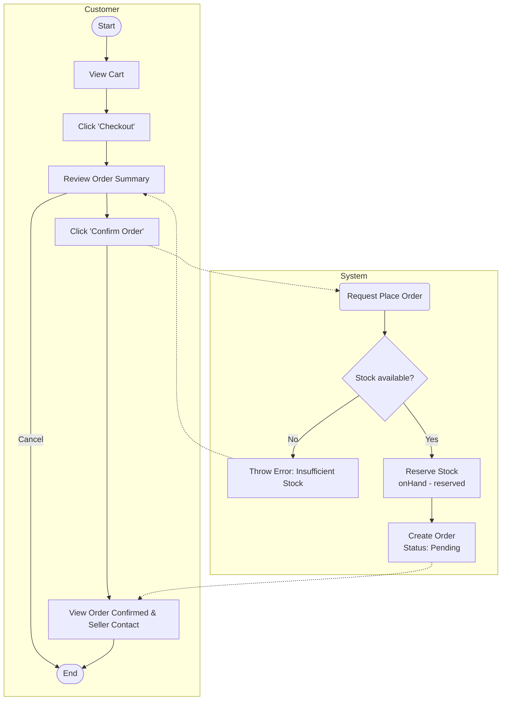
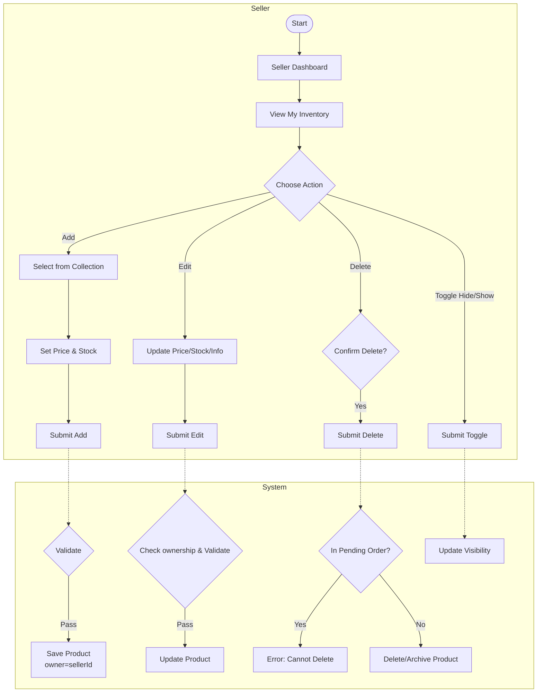
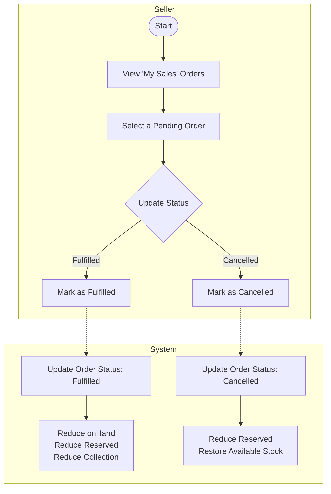
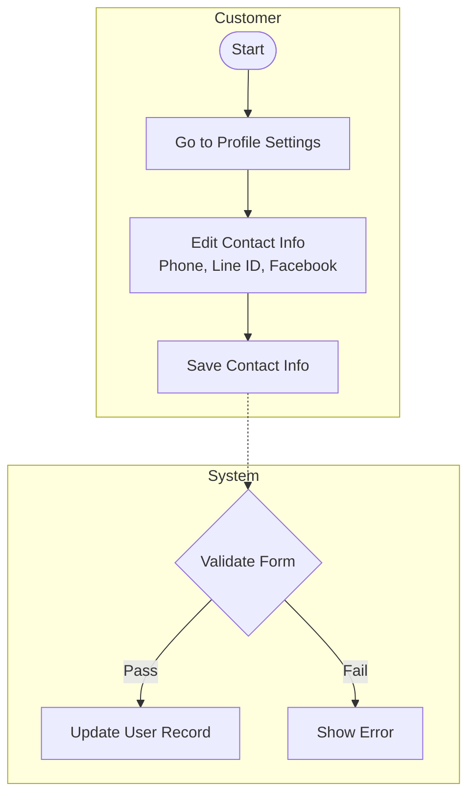
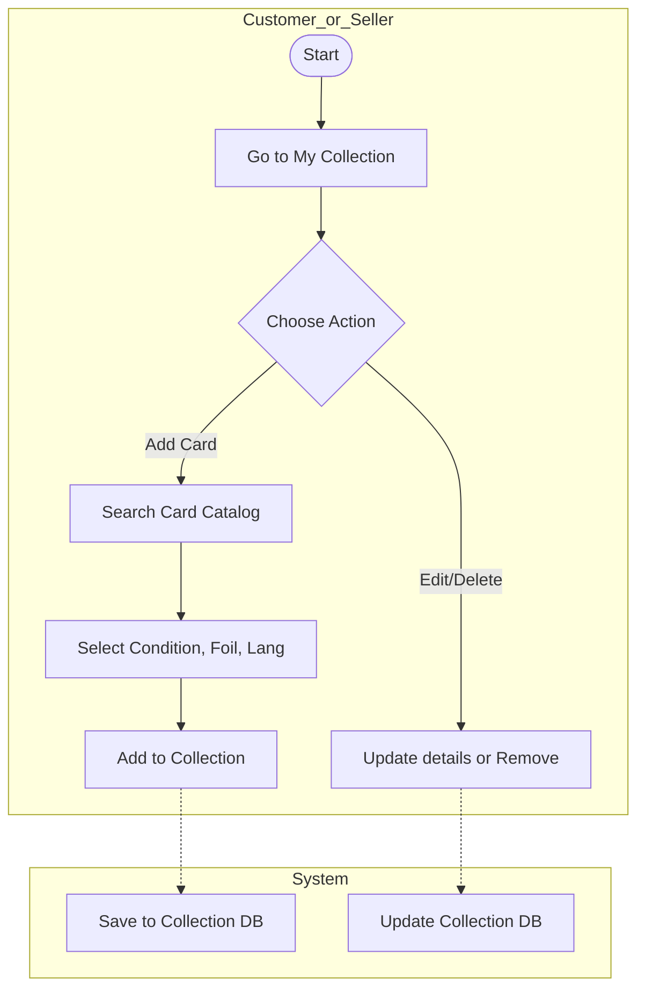
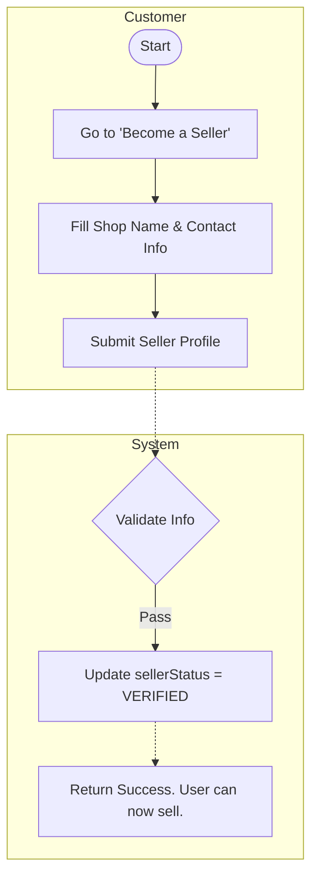
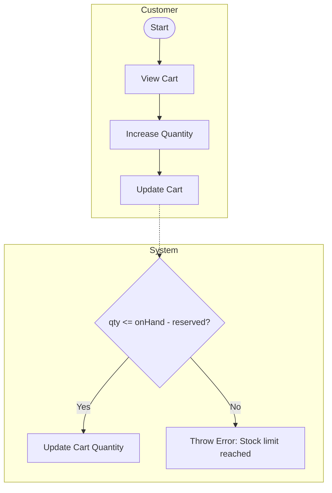

# Flowcharts Preview

Here are all the modified and new user flows. Since your IDE supports Mermaid rendering, you can view the flowcharts directly in this file.

## US-04 Place Order


## US-05 CRUD Inventory Management


## US-06 Seller Dashboard (Cost/Profit)
```mermaid
flowchart TD
    subgraph Seller
        start([Start]) --> viewDash[Open Seller Dashboard]
        viewDash --> inputCost[Input / Update Card Cost per item]
        inputCost --> saveCost[Save Cost]
        viewDash --> viewProfit[View Estimated Sales & Profit]
    end
    
    subgraph System
        saveCost -.-> dbCost[Update Cost in DB]
        viewProfit -.-> calc[Calculate Profit:\n(Price - Cost) * Qty]
        calc -.-> retProfit[Return Dashboard Metrics]
    end
```

## US-07 Order Management


## US-08 User Profile (Contact)


## US-NEW-1 Collection Management


## US-NEW-2 Seller Verification


## US-NEW-3 Stock Reservation Logic

